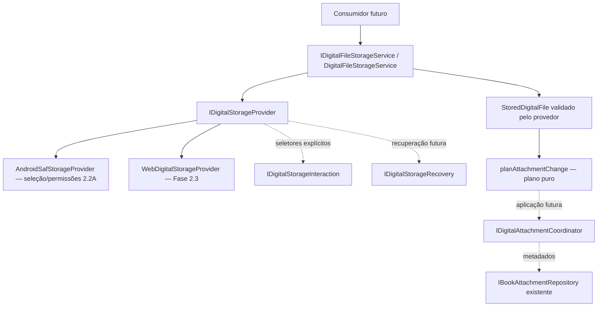

# MinhaEstante 2.0 — Fundação de Dados e Armazenamento Digital

**Documento Técnico da Fase 1 — Modelos, Esquema SQLite e Contratos Arquiteturais**

Atualizado até a **Fase 4.2A: prova técnica isolada de streaming ZIP**.
Os adendos 29–32 descrevem a evolução e sua validação; as seções anteriores são históricas.
A seção 28 e o relatório 2.4 descrevem a composição vigente, os testes reais e as
pendências. As seções anteriores preservam o contexto histórico; afirmações de
funcionalidade futura referem-se à fase então entregue.

---

## 1. Objetivos Gerais da Versão 2.0

O **MinhaEstante 2.0** evolui o aplicativo de uma ferramenta exclusivamente voltada para a catalogação estática de livros físicos e e-books para um ambiente integrado de **biblioteca pessoal digital e acompanhamento de leitura**, preservando integralmente a identidade clássica em madeira, a simplicidade de uso e o armazenamento offline.

Nesta primeira fase, foram implementados os alicerces estruturais:
- Entidades tipadas para anexos digitais, posição de leitura e ciclos de leitura.
- Esquema relacional SQLite (Versão 2) com suporte a integridade referencial estrita e migrações idempotentes.
- Repositórios de persistência desacoplados da interface visual.
- Preservação total de 100% das telas, fluxos de catalogação, busca e backups da Versão 1.1.

---

## 2. Estrutura dos Novos Modelos

### 2.1. Anexo Digital (`BookAttachment`)
Representa metadados de arquivos digitais associados a uma obra catalogada, sem armazenar dados binários no banco de dados.

```typescript
export type AttachmentType = 'ebook' | 'audiobook';
export type AttachmentFormat = 'epub' | 'pdf' | 'mp3' | 'm4a' | 'm4b';

export interface BookAttachment {
  id: string;              // UUID v4 estável
  bookId: number;          // Chave estrangeira para books.id
  type: AttachmentType;    // 'ebook' ou 'audiobook'
  format: AttachmentFormat;// 'epub' | 'pdf' | 'mp3' | 'm4a' | 'm4b'
  filename: string;        // Nome original do arquivo
  mimeType?: string | null;// MIME type inferido
  sizeBytes: number;       // Tamanho em bytes
  storageProvider: string; // Ex: 'saf_document', 'opfs', 'web_local'
  storageReference: string;// URI/caminho opaco gerenciado pelo provedor
  checksum?: string | null;// SHA-256 de integridade
  createdAt: number;
  updatedAt: number;
}
```

### 2.2. Posição de Leitura e Reprodução (`ReaderPosition`)
Retém a última localização visitada no arquivo digital (mesmo em consultas breves).

```typescript
export type ReaderLocationType = 'epub_cfi' | 'pdf_page' | 'audio_seconds';

export interface ReaderPosition {
  id: string;                        // UUID v4
  attachmentId: string;              // Chave estrangeira para book_attachments.id
  locationType: ReaderLocationType;  // 'epub_cfi' | 'pdf_page' | 'audio_seconds'
  location: string;                  // Seletor CFI, número de página ou segundos
  updatedAt: number;
}
```

### 2.3. Sessão de Leitura (`ReadingSession`)
Representa um ciclo deliberado de leitura iniciado intencionalmente pelo usuário.

```typescript
export type ReadingSessionStatus = 'active' | 'completed' | 'abandoned';

export interface ReadingSession {
  id: string;                     // UUID v4
  bookId: number;                 // Chave estrangeira para books.id
  status: ReadingSessionStatus;   // 'active' | 'completed' | 'abandoned'
  startedAt: number;
  completedAt?: number | null;
  abandonedAt?: number | null;
  updatedAt: number;
}
```

### 2.4. Progresso de Leitura (`ReadingProgress`)
Representa o avanço deliberado dentro de uma sessão de leitura ativa ou histórica.

```typescript
export type ProgressUnit = 'pages' | 'percentage' | 'seconds';
export type ProgressSource = 'manual' | 'reader_device';

export interface ReadingProgress {
  id: string;               // UUID v4
  sessionId: string;        // Chave estrangeira para reading_sessions.id
  unit: ProgressUnit;       // 'pages' | 'percentage' | 'seconds'
  currentValue: number;     // Valor atual atingido (>= 0)
  totalValue?: number | null;// Total conhecido (se aplicável, >= currentValue)
  source: ProgressSource;   // 'manual' | 'reader_device'
  updatedAt: number;
}
```

---

## 3. Diagrama de Relações entre as Entidades

```
┌───────────────────────────────────────────────────────────────┐
│                             books                             │
│  - id: INTEGER PRIMARY KEY                                    │
│  - uuid: TEXT (identificador estável multiplataforma)        │
│  - titulo, autores_json, formatos_json, status_leitura, etc.  │
└───────────────────────────────┬───────────────────────────────┘
                                │
        ┌───────────────────────┴───────────────────────┐
        │ 1:N (max 1 ebook,                             │ 1:N (histórico)
        │      max 1 audiobook)                         │
        ▼                                               ▼
┌───────────────────────────────┐               ┌───────────────────────────────┐
│       book_attachments        │               │       reading_sessions        │
│  - id: TEXT PRIMARY KEY       │               │  - id: TEXT PRIMARY KEY       │
│  - book_id: INTEGER (FK)      │               │  - book_id: INTEGER (FK)      │
│  - type: 'ebook'|'audiobook'  │               │  - status: active|completed...│
│  - format: epub|pdf|mp3...    │               │  - started_at, completed_at...│
│  UNIQUE(book_id, type)        │               │  UNIQUE(book_id) WHERE active │
└───────────────┬───────────────┘               └───────────────┬───────────────┘
                │ 1:1                                           │ 1:1
                ▼                                               ▼
┌───────────────────────────────┐               ┌───────────────────────────────┐
│       reader_positions        │               │       reading_progress        │
│  - id: TEXT PRIMARY KEY       │               │  - id: TEXT PRIMARY KEY       │
│  - attachment_id: TEXT (FK)   │               │  - session_id: TEXT (FK)      │
│  - location_type: cfi|page|sec│               │  - unit: pages|percent|seconds│
│  - location: TEXT             │               │  - current_value, total_value │
│  UNIQUE(attachment_id)        │               │  UNIQUE(session_id)           │
└───────────────────────────────┘               └───────────────────────────────┘
```

---

## 4. Esquema SQLite Introduzido (DDL Versão 2)

```sql
-- 1. Anexos de Mídia Digital (E-books e Audiolivros)
CREATE TABLE IF NOT EXISTS book_attachments (
  id TEXT PRIMARY KEY,
  book_id INTEGER NOT NULL,
  type TEXT NOT NULL,
  format TEXT NOT NULL,
  filename TEXT NOT NULL,
  mime_type TEXT,
  size_bytes INTEGER NOT NULL,
  storage_provider TEXT NOT NULL,
  storage_reference TEXT NOT NULL,
  checksum TEXT,
  created_at INTEGER NOT NULL,
  updated_at INTEGER NOT NULL,
  FOREIGN KEY (book_id) REFERENCES books(id) ON DELETE CASCADE,
  CONSTRAINT uq_book_attachment_type UNIQUE(book_id, type)
);

CREATE INDEX IF NOT EXISTS idx_book_attachments_book_id ON book_attachments(book_id);
CREATE INDEX IF NOT EXISTS idx_book_attachments_type ON book_attachments(type);

-- 2. Posição de Leitura e Reprodução
CREATE TABLE IF NOT EXISTS reader_positions (
  id TEXT PRIMARY KEY,
  attachment_id TEXT NOT NULL,
  location_type TEXT NOT NULL,
  location TEXT NOT NULL,
  updated_at INTEGER NOT NULL,
  FOREIGN KEY (attachment_id) REFERENCES book_attachments(id) ON DELETE CASCADE,
  CONSTRAINT uq_reader_position_attachment UNIQUE(attachment_id)
);

CREATE INDEX IF NOT EXISTS idx_reader_positions_attachment_id ON reader_positions(attachment_id);

-- 3. Acompanhamento Deliberado de Leitura
CREATE TABLE IF NOT EXISTS reading_sessions (
  id TEXT PRIMARY KEY,
  book_id INTEGER NOT NULL,
  status TEXT NOT NULL,
  started_at INTEGER NOT NULL,
  completed_at INTEGER,
  abandoned_at INTEGER,
  updated_at INTEGER NOT NULL,
  FOREIGN KEY (book_id) REFERENCES books(id) ON DELETE CASCADE
);

CREATE INDEX IF NOT EXISTS idx_reading_sessions_book_id ON reading_sessions(book_id);
CREATE INDEX IF NOT EXISTS idx_reading_sessions_status ON reading_sessions(status);
CREATE UNIQUE INDEX IF NOT EXISTS idx_reading_sessions_active_unique ON reading_sessions(book_id) WHERE status = 'active';

-- 4. Progresso de Leitura Acompanhado
CREATE TABLE IF NOT EXISTS reading_progress (
  id TEXT PRIMARY KEY,
  session_id TEXT NOT NULL,
  unit TEXT NOT NULL,
  current_value REAL NOT NULL,
  total_value REAL,
  source TEXT NOT NULL,
  updated_at INTEGER NOT NULL,
  FOREIGN KEY (session_id) REFERENCES reading_sessions(id) ON DELETE CASCADE,
  CONSTRAINT uq_reading_progress_session UNIQUE(session_id)
);

CREATE INDEX IF NOT EXISTS idx_reading_progress_session_id ON reading_progress(session_id);
```

---

## 5. Versão das Migrações e Idempotência

- **Versão anterior:** `CURRENT_DB_VERSION = 1` (criava `schema_migrations` e `books`).
- **Nova versão:** `CURRENT_DB_VERSION = 2`.
- **Tabela de controle:** `schema_migrations(version INTEGER PRIMARY KEY, applied_at INTEGER NOT NULL)`.
- **Comportamento Transacional e Idempotente:**
  1. A conexão executa `PRAGMA foreign_keys = ON;`.
  2. Verifica `schema_migrations`: se a versão 2 não foi aplicada, inicia transação (`BEGIN TRANSACTION`).
  3. Adiciona colunas ausentes na tabela `books` (`uuid` e `formatos_json`) via `ALTER TABLE books ADD COLUMN ...`.
  4. Executa a criação das 4 novas tabelas com cláusula `IF NOT EXISTS`.
  5. Insere `(2, Date.now())` na tabela `schema_migrations`.
  6. Finaliza a transação com `COMMIT`. Em caso de erro, executa `ROLLBACK`, preservando a consistência do banco.

---

## 6. Regras de Integridade e Restrições

1. **Chaves Estrangeiras:**
   - `book_attachments.book_id -> books.id ON DELETE CASCADE`.
   - `reader_positions.attachment_id -> book_attachments.id ON DELETE CASCADE`.
   - `reading_sessions.book_id -> books.id ON DELETE CASCADE`.
   - `reading_progress.session_id -> reading_sessions.id ON DELETE CASCADE`.
2. **Restrições de Unicidade:**
   - `UNIQUE(book_id, type)` em `book_attachments`: impede múltiplos e-books ou múltiplos audiolivros no mesmo livro.
   - `UNIQUE(attachment_id)` em `reader_positions`: cada anexo retém exatamente uma posição mais recente.
   - `UNIQUE(book_id) WHERE status = 'active'` em `reading_sessions`: impede duas sessões simultaneamente ativas para o mesmo livro.
   - `UNIQUE(session_id)` em `reading_progress`: cada ciclo de leitura possui um único progresso correspondente.

---

## 7. Diferença entre Modalidade da Obra e Arquivo Associado

- **Modalidade da Obra (`BookFormat: 'fisico' | 'ebook' | 'audiolivro'`):**
  Representa a modalidade de catalogação, independente da posse. O usuário pode marcar um livro como "E-book" sem possuir o exemplar ou qualquer arquivo digital em seu dispositivo. A posse utiliza exclusivamente `isBookOwned(book)`, sobre o campo histórico `tenho_fisico`.
- **Arquivo Associado (`BookAttachment`):**
  Representa um arquivo real (EPUB, PDF, MP3, M4A ou M4B) vinculado à obra e gerenciado por um provedor de armazenamento local.
- **Regra de Independência:**
  Vincular um arquivo digital **não altera** compulsoriamente os formatos declarados da obra, e desvincular um arquivo não apaga a modalidade correspondente na estante.

---

## 8. Diferença entre Última Posição Visitada e Progresso Deliberado

- **Última Posição Visitada (`ReaderPosition`):**
  - Associada diretamente ao anexo digital (`attachmentId`).
  - Atualizada automaticamente ao folhear uma página ou pausar um áudio.
  - Não altera o status do livro (`status_leitura`).
  - Não cria sessão de leitura.
- **Progresso Deliberado (`ReadingProgress`):**
  - Associado à decisão explícita do leitor de registrar seu avanço em uma sessão (`sessionId`).
  - Pode ser alimentado manualmente (páginas de livro físico) ou sincronizado deliberadamente a partir do leitor.
  - Distingue o fato de abrir um livro para consulta do ato consciente de acompanhamento de leitura.

---

## 9. Regras de Histórico e Releitura

1. Um livro pode acumular múltiplos ciclos históricos de leitura (`status = 'completed'` ou `'abandoned'`).
2. Quando uma sessão é concluída (`complete`), o campo `completedAt` é carimbado e ela se torna imutável no histórico.
3. O usuário pode então iniciar um novo ciclo deliberado de leitura para a mesma obra (releitura), gerando uma nova sessão com `status = 'active'`.
4. As releituras nunca sobrescrevem ou apagam as sessões anteriores, preservando estatísticas temporais e hábitos de leitura.

---

## 10. Estratégia Futura de Armazenamento (Fase 2)

Nenhum arquivo binário é armazenado como BLOB no SQLite. Na Fase 2:
- **Android:** Utilizará o Storage Access Framework (SAF) e o seletor de documentos do sistema operacional, armazenando no banco apenas URIs persistentes seguras (`takePersistableUriPermission`) ou referências copiadas para o diretório de dados privados do aplicativo (`FilesystemDirectory.Data`).
- **Web / PWA:** Utilizará o Origin Private File System (OPFS) ou IndexedDB com URLs de Blob efêmeras criadas sob demanda.
- **Detecção de Arquivos Inacessíveis:** A arquitetura prevê validação assíncrona da existência do arquivo antes da abertura nos leitores, sinalizando arquivos ausentes ou movidos sem corromper o registro bibliográfico.

---

## 11. Estratégia Futura de Backup

- **Backup Padrão (Versão 1.1):** Preservado integralmente. Exporta o catálogo bibliográfico e capas locais portáteis no arquivo ZIP com o manifesto existente.
- **Evolução Opcional (Fase Futura):**
  - Checkbox opcional: `[ ] Incluir arquivos de e-books (EPUB/PDF)`.
  - Checkbox opcional: `[ ] Incluir arquivos de audiolivros (MP3/M4A/M4B)`.
  - Ambos iniciam **desmarcados por padrão**, mantendo o backup rápido e leve.
  - Caso selecionados, o manifesto do ZIP conterá a tabela de anexos e os arquivos correspondentes serão embutidos em pastas dedicadas (`ebooks/`, `audiobooks/`).

---

## 12. Compatibilidade com a Versão 1.1

- **Telas e Componentes:** Nenhuma tela (Início, Estante, Pesquisa, Detalhes, Editar, Estatísticas) foi alterada.
- **Formatos:** A seleção múltipla e independente de `fisico`, `ebook` e `audiolivro` permanece 100% preservada.
- **Persistência de Livros:** A tabela `books` preserva todos os registros e colunas anteriores. A coluna `uuid` adicionada é retrocompatível e transparente.
- **Restauração de Backups:** Backups criados na versão 1.1 continuam sendo restaurados com sucesso.

---

## 13. Contratos Disponíveis para a Próxima Fase (Fase 2)

Os seguintes contratos estão prontos e testados para consumo na Fase 2:
1. `bookAttachmentRepository`: Métodos `create`, `getById`, `getByBookAndType`, `getByBookId`, `update`, `delete`, `exists`.
2. `readerPositionRepository`: Métodos `savePosition`, `getByAttachmentId`, `deleteByAttachmentId`, `validateLocation`.
3. `readingSessionRepository`: Métodos `create`, `getActiveSession`, `getHistoryByBookId`, `complete`, `abandon`.
4. `readingProgressRepository`: Métodos `saveProgress`, `getBySessionId`, `validateProgress`.
5. `isValidAttachmentTypeAndFormat` e `isValidReaderLocation`: Validadores puros de domínio.

---

## 14. Fase 2.1 — Escopo efetivamente implementado

A entrada pública é `src/services/storage/digital/index.ts`. Foram criados contratos,
validação estrutural, erros padronizados, despacho para provedores injetados e planejamento
puro de associação. A Fase 2.2A acrescentou um provedor Android limitado a seleção,
metadados e permissões (seção 23). Não existe provedor Web/OPFS, cópia definitiva,
journal, recuperação executável ou orquestrador de banco/arquivos.
Somente o diagnóstico DEV compõe o provedor Android. A fábrica sem provedores retorna
`PROVIDER_UNAVAILABLE`; não há fallback que simule armazenamento bem-sucedido.



O serviço conhece apenas contratos e validadores puros. Não importa React, Capacitor,
Filesystem, APIs OPFS ou instâncias de repositórios. Os provedores não recebem `Book` e
não podem decidir posse, modalidades, leitura, sessões ou progresso. Os tipos de formato
e categoria reutilizam `digitalMedia.ts`; não foi criada outra entidade equivalente a
`BookAttachment`.

## 15. Contratos públicos e seleção do provedor

| Contrato | Responsabilidade |
| --- | --- |
| `IDigitalStorageProvider` | Capacidades, configuração consultável, importação, metadados, acesso, integridade, handles de leitura e exclusão gerenciada. |
| `IDigitalStorageInteraction` | Solicitações explícitas de configuração e seleção da origem. Separadas das operações sobre referências já concedidas. |
| `IDigitalStorageRecovery` | Contrato futuro para listar pendências, descartar provisórios e confirmar resolução do journal após associação/compensação; sem implementação atual. |
| `IDigitalFileStorageService` | API compartilhada independente de plataforma. |
| `DigitalFileStorageService` | Valida argumentos/respostas, consulta capacidades, faz preflight de importação e despacha para os provedores injetados. |
| `IDigitalAttachmentCoordinator` | Contrato futuro para aplicar associação/substituição e desassociação lógica usando os repositórios. Sem implementação atual. |

`new DigitalFileStorageService(providers, defaultProviderId)` permite injeção simples.
`createDigitalFileStorageService(platform, providers)` centraliza o mapeamento das
plataformas fornecidas pela composição futura: Android → `saf_document`, Web → `web_digital`.
Não há detecção automática da plataforma nesta fase. Os testes fornecem fakes locais.
IDs duplicados são rejeitados. O provedor padrão serve apenas para configuração/seleção;
acesso a um arquivo usa sempre o `storageProvider` da referência persistida.

`getCapabilities()` é um snapshot síncrono. `selectSource()` e
`requestConfiguration()` despacham para a implementação no mesmo turno, antes de um
`await`, preservando a possibilidade de ativação direta pelo usuário. O provedor futuro
deve abrir seu seletor antes do primeiro `await`; o literal `user-initiated` expressa a
intenção da chamada, mas não cria uma autorização do sistema. Consultas e importações
nunca abrem seletores ou solicitam permissões implicitamente.

## 16. Modelos e referências opacas

| Tipo | Significado e duração |
| --- | --- |
| `SelectedDigitalFile` | Seleção ainda externa, sem bytes: origem, nome de exibição, MIME e tamanho opcional. `access` descreve potencial de duração, não acesso atual. |
| `SourceFileReference` | Token de seleção/URI concedida. O provedor Web poderá manter o objeto selecionado no seu registro privado, sem serializá-lo no domínio. |
| `LibraryLocationReference` | Identidade da localização padrão, distinta de cada arquivo existente. |
| `ManagedFileReference` | Par serializável `storageProvider` + `storageReference`, com discriminante `managed`. |
| `DigitalImportProgress` | Operação em validação, preparação, cópia, verificação ou confirmação; contadores sem conteúdo binário. |
| `StoredDigitalFile` | Resultado de importação confirmada e recuperável, com metadados, tamanho verificado, SHA-256 e ID da operação. Ainda não está associado a um livro. |
| `DigitalReadAccess` | Token efêmero para consumidor nativo ou stream do provedor; precisa de liberação e não substitui a referência persistida. |

`OpaqueReference<Kind>` marca nominalmente strings de origem, arquivo gerenciado,
localização, leitura e operação incompleta. As fábricas validam estrutura e preservam
o conteúdo; não resolvem, concatenam ou convertem `content://` em caminho absoluto.
As marcas TypeScript desaparecem na serialização: reidratar uma referência exige
validá-la novamente e consultar o provedor, que decide se ela existe e é autorizada.

O nome original não é identidade. A Fase 2.2/2.3 deverá manter um registro durável de
identidades próprias, independente do nome e da pasta padrão atual. A troca da pasta
vale para novas importações; referências anteriores continuam resolvidas pela localização
original. Não se deve substituir todas as URIs por concatenação com a nova pasta.

Capacidade, permissão e acessibilidade são dimensões separadas:

- `StorageCapabilities.implemented`: recursos realmente implementados.
- `StorageCapabilities.available`: subconjunto utilizável no ambiente atual.
- `providerAvailability`: disponibilidade do provedor como um todo.
- `StorageConfiguration`: localização configurada e permissão `granted`, `denied`,
  `revoked` ou `unknown`.
- `checkAccess(reference)`: resultado atual para aquele arquivo. Permissão persistida
  ou capacidade disponível não garantem sua presença.

## 17. Resultados, erros e validação

Todas as operações assíncronas retornam `StorageResult<T>`:

```typescript
type StorageResult<T> =
  | { status: 'success'; value: T }
  | { status: 'cancelled'; code: 'USER_CANCELLED' | 'OPERATION_CANCELLED' }
  | { status: 'error'; error: DigitalStorageError };
```

`DigitalStorageError` contém apenas `code` e `messageKey` (`digitalStorage.errors.CODE`),
preparando traduções futuras sem alterar a interface atual. `errors.ts` preserva causas
tipadas, normaliza erros desconhecidos para `OPERATION_FAILED` e não propaga mensagens,
stack, conteúdo ou caminhos privados vindos de APIs/bridge. O provedor deve traduzir
erros nativos e cancelamento de seletor de acordo com o contexto; `AbortError` genérico
é normalizado como cancelamento de operação.

Os códigos incluem configuração ausente, autorização ainda desconhecida, permissão
negada/revogada, arquivo ausente/inacessível, formato não suportado, arquivo inválido,
espaço insuficiente, divergência de integridade, cancelamentos e indisponibilidade.
`UNSUPPORTED_OPERATION`, `INVALID_REFERENCE`, `PROVIDER_MISMATCH`, `ATTACHMENT_CONFLICT`
e `OPERATION_CONFLICT` cobrem violações de contrato e conflitos de identidade/estado da
operação. Integridade divergente nunca vira sucesso ou aviso silencioso.

`validation.ts` normaliza apenas campos permitidos. Valida nomes de exibição sem caminhos,
tamanhos inteiros seguros, formato canônico, SHA-256 hexadecimal de 64 caracteres,
IDs/provedor, discriminantes e coerência de tamanho. A validação é **estrutural**:
ela não lê bytes e não comprova conteúdo, durabilidade ou autorização. Seleção aceita
tamanho desconhecido ou zero; importação e arquivo confirmado continuam exigindo tamanho positivo.
Essa comprovação
é obrigação da implementação real do provedor; resultados dos fakes não são evidência de I/O.

## 18. Importação segura e arquivos grandes

O ciclo contratado é:

1. Seleção explícita → `SelectedDigitalFile`; seleção cancelada é resultado próprio.
2. Validação estrutural/categoria e preflight de configuração e acesso da origem.
3. Preparação com `operationId` idempotente registrado duravelmente pelo provedor futuro.
4. Cópia incremental/nativa para arquivo provisório exclusivo.
5. Validação real de formato/conteúdo, contagem de bytes e SHA-256 incremental;
   conferir o destino e o hash da cópia, sem confiar só em nome/MIME.
6. Confirmação recuperável do arquivo pelo provedor → `StoredDigitalFile`.
7. Planejamento e associação posterior pelo orquestrador, usando `BookAttachmentRepository`.

O contrato não possui `readAll`, Base64 obrigatório, `Blob` ou `ArrayBuffer` completos.
A importação exige SHA-256 e uma estratégia disponível: cópia nativa, ou leitura e escrita
incrementais. Origem de tamanho desconhecido é permitida; o resultado confirmado precisa
de tamanho conhecido e coerente. O serviço rejeita respostas de outra operação, provedor,
formato ou tamanho. Cancelamento usa `AbortSignal` quando suportado; progresso usa callback
somente quando disponível. Tokens/contadores podem atravessar a bridge; bytes de audiolivros
devem permanecer no fluxo nativo.

Não existe transação distribuída entre SQLite e arquivos. O contrato de recuperação prevê
estados provisórios por ID de operação e arquivos confirmados ainda sem vínculo. Falta de
espaço, revogação, origem removida, cancelamento ou encerramento inesperado deverão deixar
evidência recuperável no registro privado do provedor. Se o arquivo já foi confirmado,
o sucesso de confirmação deve prevalecer sobre cancelamento tardio; não descartar a
referência que permite recuperar um arquivo recém-criado. Se a gravação dos metadados
falhar, o plano mantém o novo arquivo sem vínculo para recuperação/compensação posterior.
Nenhum journal, cópia, SHA-256 real ou compensação executável foi implementado nesta fase.

## 19. Associação, substituição e remoção

`BookAttachmentCreateInput` deriva diretamente do argumento de
`IBookAttachmentRepository.create`. `planAttachmentChange(request, currentSlot)` é puro:
produz os metadados necessários, não consulta banco nem modifica `Book`. O slot deve ser
obtido por `getByBookAndType`. E-book e audiolivro têm slots separados.

Um slot ocupado exige `intent: 'replace'` e `expectedAttachmentId` correspondente. O plano
retém a referência anterior, não emite exclusão física e marca a política de posição como
`requires-integration-decision`. Não copia IDs ou posições antigas para o novo conteúdo.
Posse, modalidades, leitura, sessões e progresso não participam do plano.

O orquestrador futuro deverá reconsultar o slot e impedir concorrência antes de gravar,
usando transação compatível com a camada SQLite existente. O plano é um snapshot, não
uma reserva ou garantia de compare-and-swap. O arquivo anterior só poderá ser considerado
para limpeza após confirmação do novo vínculo e comprovação de ausência de outras
referências. Falha preserva o vínculo anterior.

`DetachAttachmentRequest` (`detach-only`) remove apenas vínculo lógico. Já
`DeleteManagedFileRequest` exige referência gerenciada e intenção `delete-managed-file`.
Discriminantes e marcas não concedem autorização: o provedor deve comprovar pertencimento
ao seu registro, nunca excluir uma URI externa arbitrária. Excluir um livro/linha SQLite
não dispara exclusão no armazenamento compartilhado. A recuperação futura deve listar
apenas operações/arquivos da própria biblioteca, sem varredura ou limpeza fora desse escopo.

## 20. Requisitos para Fase 2.2 — Android SAF

O `AndroidSafStorageProvider` implementa `IDigitalStorageProvider`, com ID `saf_document`.
Seleção e permissões foram implementadas na 2.2A; cópia e integridade serão 2.2B. Requisitos:

- Pasta escolhida por `ACTION_OPEN_DOCUMENT_TREE`; origem por `ACTION_OPEN_DOCUMENT`.
- Preservar URI e concessões realmente recebidas; chamar `takePersistableUriPermission`
  somente com flags concedidas e suporte persistível. Não assumir autorização permanente.
- Acessar documentos com `ContentResolver`, sem conversão de URI em caminho absoluto.
- Copiar e calcular SHA-256 em fluxos nativos com memória limitada, cancelamento e progresso;
  não enviar o arquivo completo pela bridge Capacitor.
- Tratar concessão revogada, documento movido/removido, tamanho desconhecido, espaço e
  restrições dos seletores em Android moderno. Reabrir após reinício e testar em dispositivo.
- Não solicitar `MANAGE_EXTERNAL_STORAGE`. Solicitar apenas acesso necessário às
  localizações selecionadas; conferir capacidades efetivas do documents provider.

Referência: [Android — documentos e arquivos compartilhados](https://developer.android.com/training/data-storage/shared/documents-files).

## 21. Requisitos para Fase 2.3 — Web/PWA

O futuro `WebDigitalStorageProvider` terá identidade estável `web_digital`, independentemente
do backend escolhido. OPFS permite armazenamento privado por origem, sujeito a quota e
remoção dos dados do site. Sua disponibilidade não equivale a permissão de seletor externo,
persistência garantida ou presença do arquivo. Avaliar quota, persistência e fallback em
IndexedDB com limites explícitos. Não usar localStorage para binários grandes.

Seletores externos podem exigir ativação transitória do usuário. A origem selecionada pode
ser mantida em registro efêmero de `File`/handle; só o token atravessa o domínio. Não prometer
reabertura dessa seleção após reinício sem suporte efetivo. Arquivos gerenciados precisam
de identidade durável, leitura/escrita incremental e hashing incremental; `crypto.subtle.digest`
com buffer do arquivo inteiro não satisfaz o contrato para audiolivros grandes.

Referências: [OPFS](https://developer.mozilla.org/en-US/docs/Web/API/File_System_API/Origin_private_file_system),
[seleção de arquivos e ativação do usuário](https://developer.mozilla.org/en-US/docs/Web/API/Window/showOpenFilePicker).

## 22. Limitações atuais e decisões de integração pendentes

- Definir formato/versionamento do registro privado de localizações e arquivos, journal
  durável e política de retenção de importações incompletas, sem migração inesperada da
  bibliografia. O mecanismo real deverá resistir a interrupção/reinício.
- SAF não garante rename/commit atômico em todo documents provider. Definir confirmação
  por registro/marker e capacidade observada, sem expor arquivo parcial como anexo.
- Plugin/bridge Kotlin, Activity result e cancelamento de seletores foram criados na 2.2A.
  Cancelamento de importação e progresso continuam pendentes para 2.2B.
- Decidir validação de conteúdo por formato e estratégia de verificação incremental do
  destino. O serviço apenas valida as evidências estruturais declaradas pelo provedor.
- Definir política de ReaderPosition na substituição: o repositório atual permite `update`
  do mesmo ID e não invalida posições sozinho. Não aplicar o plano antes dessa decisão.
- O repositório atual não oferece compare-and-swap, journal de arquivos ou consulta por
  referência para contagem de vínculos. Coordenar concorrência/limpeza explicitamente
  na integração, sem alterar o adaptador nativo estabilizado nesta fase.
- Anexos legados podem não ter checksum. Não declarar verificação SHA-256 contra um hash
  esperado inexistente. Definir validação limitada/aquisição de checksum na integração.
- Os campos existentes `storageProvider`/`storageReference` são strings livres. Identidades
  antigas como `opfs`/`web_local` exigirão reconhecimento/aliases explícitos do provedor
  futuro, sem reescrita automática dos vínculos.
- Os tipos históricos em `digitalMediaArchitecture.ts` permanecem para compatibilidade;
  seus descritores não são a entidade operacional. O modelo canônico é `BookAttachment`
  em `digitalMedia.ts`, reutilizado pelos contratos novos.
- Nenhuma integração ao ZIP foi feita. Backup digital, leitores, player, telas e
  acompanhamento deliberado continuam em fases posteriores.

Os testes novos da Fase 2.1 usam exclusivamente fakes de metadados e banco em memória. A suíte anterior
continua responsável pelas regressões já existentes, inclusive o backup de referência e
SQLite desktop isolado. Esses testes não comprovam SAF, OPFS ou SQLite Android nativo.

Validação da entrega 2.1: **378 testes aprovados (26 arquivos), 70 novos, zero falhas**;
`npm run lint` aprovado; build Web/PWA via Vite aprovado, com aviso de bundle acima de
500 kB. O build foi direcionado a `/tmp`, sem executar `cap sync` ou gerar APK/AAB.
Nenhum provedor real foi executado ou arquivo digital real importado por essa camada.

## 23. Fase 2.2A — plugin Kotlin, seleção e concessões SAF

`DigitalLibraryStoragePlugin.kt` é um plugin local Capacitor 8, registrado por
`MainActivity` antes de `super.onCreate`. Usa `@CapacitorPlugin`, `@PluginMethod` e
`@ActivityCallback`; o `startActivityForResult` do **Plugin** usa os launchers Activity
Result do Capacitor instalado, não a API legada de Activity. A bridge antiga de backup
em `MainActivity` foi preservada. Referência: [guia Android do Capacitor 8](https://capacitorjs.com/docs/plugins/android).

| Método nativo | Comportamento |
| --- | --- |
| `getConfiguration` | Consulta configuração e concessões atuais, sem seletor. |
| `selectDirectory` | Exige `user-initiated`, abre `ACTION_OPEN_DOCUMENT_TREE`, recebe flags, tenta persistir somente leitura/escrita concedidas e registra a configuração. |
| `selectDocument` | Exige interação explícita, abre `ACTION_OPEN_DOCUMENT` com `CATEGORY_OPENABLE`; retorna metadados de EPUB/PDF/MP3/M4A/M4B, sem ler o conteúdo. |
| `getSelectedMetadata` | Reconsulta nome, MIME e tamanho, aceitando somente token emitido pelo registro nativo. |
| `checkSourceAccess` | Revalida concessão e metadados; abre e fecha descritor de leitura, sem consumir o arquivo. |
| `getDevelopmentEnvironment` | Informa se é `BuildConfig.DEBUG` **e** package `com.booknookapp.dev`. |
| `runDiagnostics` | Bloqueado fora da variante DEV e sem interação explícita. Cria arquivo pequeno exclusivo, escreve/lê bytes fixos e tenta excluir apenas o documento criado. Expõe falha de limpeza separadamente. |

O registro privado `digital_library_saf_v1` usa SharedPreferences com `MODE_PRIVATE`
e `commit()` conferido. Mantém `active`, referências `tree.<UUID>`, evidência de concessão
anterior `treeHadRead.<UUID>` e origens persistidas `source.<UUID>`. As URIs ficam somente
nessa camada. A bridge recebe/devolve UUIDs opacos, não aceita URIs fornecidas pelo JS.
Não há tabela SQLite nova. Origens somente de sessão ficam em memória nativa e não têm
promessa de recuperação após recriação/encerramento; origens persistidas ficam no registro.
Esse registro **não** é o journal ou registro de arquivos gerenciados da 2.2B.

Ao trocar de pasta, as referências e concessões antigas são mantidas. Não há varredura,
migração ou remoção de conteúdo. Seletores cancelados retornam `USER_CANCELLED` e não
substituem a configuração. Há bloqueio de seletores concorrentes (`OPERATION_CONFLICT`).
O estado de seletor pendente acompanha o mecanismo de `saveInstanceState`/`restoreState`
do Capacitor. Após perda do processo, a Promise JavaScript antiga pode deixar de existir:
a configuração é reconsultável e o Capacitor pode entregar `appRestoredResult`; integrar
esse evento à futura UI é trabalho posterior. Não há retomada fictícia de importação.

`getConfiguration` consulta `persistedUriPermissions` antes de acessar a URI salva.
`DocumentsContract` valida a árvore, o tipo diretório e `FLAG_DIR_SUPPORTS_CREATE`.
As flags indicam capacidade declarada; somente o diagnóstico explícito confirma escrita
real naquele momento. Não se cria arquivo em consultas de configuração.

| Estado SAF | Permissão genérica | Significado |
| --- | --- | --- |
| `not-configured` | Não se aplica | Sem pasta escolhida. |
| `accessible` | `granted` | Leitura/escrita persistidas e provedor anuncia criação. |
| `read-only` | `denied` | Leitura persistida, sem escrita ou sem capacidade de criar. |
| `permission-required` | `unknown` | Escolha registrada, mas leitura persistida nunca obtida. |
| `permission-revoked` | `revoked` | Leitura antes persistida não consta mais nas concessões. |
| `permission-denied` | `denied` | Concessão consta, mas provedor nega acesso. |
| `missing` | `unknown` | Provedor sinaliza documento ausente. |
| `provider-unavailable` | `unknown` | Autoridade ausente ou provedor morto. |
| `unavailable` | `unknown` | Outra falha de acesso/metadados; não se presume arquivo removido. |

Esses estados dependem das evidências fornecidas pelo documents provider; nuvem offline,
movimentação ou remoção nem sempre têm diagnóstico inequívoco. A UI deve oferecer
reconsulta/reconfiguração, sem apagar a referência antiga. Reiniciar o app não reabre
seletores: a pasta é recuperada das preferências e a autorização é verificada novamente.

O filtro de documentos usa `*/*` intencionalmente, porque provedores classificam EPUB/M4B
como tipos genéricos. Após seleção, valida a extensão aceita, sem diferenciar formato pelo
MIME incorreto. O tamanho pode ser desconhecido ou zero; MIME ausente/inválido é omitido.
A validação definitiva do conteúdo e a importação de arquivos vazios continuam separadas.

`src/services/storage/digital/android/` é uma entrada separada que depende de Capacitor.
O núcleo `DigitalFileStorageService` continua independente do SDK. `AndroidSafStorageProvider`
reutiliza contratos, normalizadores e erros; `getSafStatus`, `getSelectedMetadata` e
`runDiagnostics` são extensões Android. Somente configure/selectDirectory/selectFile/
persistAccess são anunciadas como implementadas. Importação, streams, SHA-256, handles
de leitor e exclusão gerenciada retornam `UNSUPPORTED_OPERATION`. Nenhum método associa
anexos ou muda livro, posse, modalidades, status, posição ou sessão.

## 24. Diagnóstico isolado e validação da 2.2A

- `debug` tem applicationIdSuffix `.dev`, nome **MinhaEstante DEV**, assinatura debug e
  sandbox/UID separados. `applicationId`, assinatura e versionCode/versionName de release
  foram preservados. SQLite usa `Context.getDatabasePath`; preferências e `Directory.Data`
  ficam no sandbox próprio. Não foi feito acesso ao banco principal.
- `diagnostics/index.html`, `src/dev/saf/` e `vite.saf-diagnostics.config.ts` constituem
  bundle separado, sem importação pela entrada de produção ou mudança de navegação.
  A tela valida o gate nativo antes de renderizar; o endpoint de escrita diagnóstica também
  exige debug + ID `.dev`, mesmo que alguém copie o HTML para outra variante.
- `bash scripts/build_android_saf_debug.sh` executa tipos, build dedicado e `assembleDebug`.
  `GRADLE_BIN` pode apontar para o Gradle local. A propriedade `digitalDiagnosticAssets`
  só aceita tarefas debug explícitas e substitui todos os assets normais pelo bundle de
  teste/configuração, sem fixtures pessoais, mídia, backup ou `cap sync`. Não instala.
- O script usa os JSONs Capacitor já sincronizados no ambiente local. Em checkout sem esses
  arquivos, eles precisam ser preparados antes; o script não sincroniza/publica assets por conta própria.
- O APK foi inspecionado com aapt/apksigner e ZIP: ID `.dev`, versão 31/2.0-31 preservada,
  certificado Android Debug, três assets públicos do diagnóstico, nenhum ZIP/mídia pessoal.
- Manifest do app sem alterações: INTERNET, ACCESS_NETWORK_STATE, CAMERA e recursos
  opcionais de câmera. O merge existente acrescenta USE_BIOMETRIC/USE_FINGERPRINT e
  permissão interna do AndroidX, não permissões amplas de armazenamento. Não foram
  adicionadas MANAGE_EXTERNAL_STORAGE, WRITE/READ_EXTERNAL_STORAGE ou READ_MEDIA_AUDIO.
- Log nativo dedicado `MinhaEstanteSAF`, somente DEV, contém eventos/códigos fixos.
  O bundle de teste desativa logging genérico Capacitor e mostra estados, formato, MIME
  e tamanho, sem nome completo, conteúdo ou URI. A depuração WebView é habilitada só no
  bundle DEV para os testes locais.

Evidências locais em 25/10/2026: **413 testes Vitest aprovados em 27 arquivos**
(378 anteriores + 35 de bridge simulada); TypeScript aprovado; build Web/PWA aprovado
(aviso prévio de chunk >500 kB); build dedicado aprovado; `assembleDebug` e
`testDebugUnitTest` aprovados. JVM: três testes novos de máscara de concessão,
extensões e capacidade de pasta, além do exemplo existente. JVM/Vitest **não** comprovam
permissões SAF reais. A regressão do ZIP histórico continua aprovada em SQLite desktop
isolado, com 215 livros, 207 capas, 141 possuídos, 74 sem posse, 97 lidos e 3 Quero Ler.

Dispositivo físico detectado: modelo 22101316G (ruby), Android 14/API 34, ADB autorizado
(`device`). SDK local, Java 21 e Gradle 8.14.3 disponíveis. A primeira tentativa foi
recusada com `INSTALL_FAILED_USER_RESTRICTED`; após confirmação do usuário, a instalação
`.dev` passou. UIDs distintos verificados; versão/datas de instalação e atualização do
app principal idênticas antes/depois. O diagnóstico abriu e a bridge real foi exercitada
pela WebView da variante DEV: plugin registrado, gate DEV habilitado, configuração inicial
ausente, URI arbitrária recusada como `INVALID_REFERENCE`, interação implícita recusada
como `PERMISSION_REQUIRED`, formatos vazios recusados como `UNSUPPORTED_FORMAT` e teste
de escrita sem pasta recusado como `NOT_CONFIGURED`. Esses resultados foram obtidos no
Android real, não em Vitest. Os resultados de seleção e persistência estão detalhados abaixo.
Não reiniciar o celular sem autorização adicional.

Testes já concluídos no aparelho com interação do usuário: pasta de teste escolhida e
autorizada; estado `accessible`, leitura/escrita persistidas e capacidade de criar;
diagnóstico com escrita, leitura e limpeza aprovadas. Os seletores de pasta e documento
foram cancelados manualmente e retornaram `USER_CANCELLED`; a configuração permaneceu
idêntica. A injeção de eventos ADB foi bloqueada por `INJECT_EVENTS`, sem alterar ajustes
de segurança do celular. Depois de `am force-stop com.booknookapp.dev` e reabertura do
mesmo pacote, a concessão continuou válida e o teste de escrita/leitura/limpeza passou
novamente. O aparelho **não** foi reiniciado.

Também concluídos: seleção de EPUB/PDF e dos três arquivos com extensão MP3/M4A/M4B;
reconsulta de metadados e abertura/fechamento de descritores das seis origens persistidas
após nova abertura do DEV; seleção da mesma pasta, de outra pasta e retorno à original.
As duas referências de árvore e as seis origens permaneceram no registro; os acessos
anteriores continuaram válidos. Fixtures sintéticas foram preparadas em uma pasta nova
`Download/MinhaEstante-SAF-Fixtures-22A-f72a64`, sem copiar arquivos pessoais. EPUB/PDF
têm conteúdo sintético; os três áudios são **vazios**, comprovando seleção, extensão,
metadados zero e disponibilidade do descritor, sem validar áudio ou reprodução.

O teste de origem removida encontrou e corrigiu uma regressão real: o provedor local
retorna cursor de metadados nulo quando o documento é removido. Isso era classificado
indevidamente como `PROVIDER_UNAVAILABLE`. Agora, cursor nulo/vazio de origem usa somente
abertura/fechamento de descritor para distinguir `FileNotFoundException` de metadados
indisponíveis, sem consumir o arquivo. Cursor nulo de diretório é `FILE_UNAVAILABLE`,
não prova de ausência do provedor. O APK DEV corrigido foi atualizado preservando as
preferências; o caso foi repetido no aparelho: `getSelectedMetadata` e `checkSourceAccess`
retornaram **FILE_NOT_FOUND** após remover exclusivamente o PDF sintético criado pelo
teste. O mesmo arquivo foi restaurado em `finally`; metadados e leitura voltaram a passar.
Os cinco formatos, a configuração persistida e o diagnóstico de escrita/leitura/limpeza
continuaram aprovados na atualização. Nenhum documento pessoal foi removido/modificado.

| Teste | Resultado | Ambiente/evidência |
| --- | --- | --- |
| Registro do plugin e gate DEV | Aprovado | Android físico, bridge real pela WebView DEV. |
| Seleção de pasta, mesma pasta, outra pasta e retorno | Aprovado | Interação humana nos seletores oficiais e referências privadas conferidas sem URIs em logs. |
| Leitura/escrita reais e limpeza | Aprovado | Arquivo diagnóstico próprio antes/depois de reabertura e após atualização do DEV. |
| Persistência da pasta após encerrar app | Aprovado | `force-stop` exclusivamente DEV, nova abertura, flags persistidas e novo diagnóstico. |
| Seleção/metadados de EPUB/PDF | Aprovado | Documentos sintéticos selecionados; origens reconsultadas e descritores acessíveis. |
| Seleção/metadados de MP3/M4A/M4B | Aprovado com escopo limitado | Arquivos vazios; sem validação de conteúdo/decodificação/reprodução. |
| Cancelamento de pasta/documento | Aprovado | `USER_CANCELLED` real, configuração preservada. |
| Origem de teste removida | Aprovado após correção | `FILE_NOT_FOUND` real para metadados e acesso; fixture restaurada. |
| URI arbitrária e interação implícita | Aprovado | `INVALID_REFERENCE`/`PERMISSION_REQUIRED` reais. |
| Pasta somente leitura, revogação e provedor indisponível | Pendente no aparelho | Estados/propagação cobertos por testes simulados/política JVM; não foram induzidos no Android real. |
| Recriação/perda de processo durante seletor pendente | Pendente | Hooks implementados; não confundir com encerramento/reabertura depois de configurar. |
| Reinício do celular | Pendente | Não autorizado/executado. |
| TypeScript e build Web/PWA | Aprovado | Local; bundle de produção não contém a entrada diagnóstica. |
| Kotlin/Gradle debug e testes JVM | Aprovado | SDK/JVM locais; quatro testes JVM, não instrumentados. |
| Suíte Vitest | Aprovado | 413 testes, 27 arquivos; simulações e SQLite desktop, sem substituir os testes físicos acima. |

Roteiro no diagnóstico: selecionar pasta própria de teste; consultar capacidades; testar
escrita/leitura/limpeza; cancelar nova seleção e confirmar configuração mantida; selecionar
a mesma pasta e outra pasta, sem mover conteúdo; selecionar EPUB/PDF/MP3/M4A/M4B próprios;
conferir metadados e leitura; encerrar **somente** `com.booknookapp.dev`, reabrir e consultar
persistência. Testar leitura somente, revogação, origem removida e provedor indisponível
somente em referências/pastas de teste isoladas. Não revogar concessões nem remover
arquivos potencialmente usados pela instalação principal. Reinício do aparelho é manual
e permanece pendente até autorização expressa.

Próxima etapa **2.2B**: registro/journal durável de operações e arquivos gerenciados,
cópia nativa incremental, validação de conteúdo, SHA-256, integridade de destino,
cancelamento/progresso, falta de espaço, confirmação recuperável e limpeza segura.
Os tokens de origem/localização e a consulta de permissões já fornecem a entrada;
nenhum `StoredDigitalFile` real é produzido na 2.2A.

## 25. Fase 2.2B — armazenamento gerenciado Android

### Fluxo e responsabilidades

O `DigitalLibraryStoragePlugin` existente foi ampliado, preservando seletores,
concessões e tokens da 2.2A. `DigitalStorageCore.kt` contém o motor sem dependências
Android, `BasicMediaValidation.kt` verifica formatos e `AndroidMetadataFiles.kt`
persiste somente metadados técnicos com `AtomicFile` no diretório privado
`files/digital-storage-v1`. `DigitalStorageDevFixtures.kt` gera fontes sintéticas
somente com gate nativo `DEBUG && packageName == com.booknookapp.dev`.

`AndroidSafStorageProvider` adapta o mesmo serviço e contratos da 2.1. A nova porta
`IDigitalStorageJournal`, em `operations.ts`, transporta snapshots normalizados,
recibos de vínculo e recuperação, sem URIs. `DigitalAttachmentCoordinator.ts`
reutiliza `BookRepository`, `BookAttachmentRepository` e `ReaderPositionRepository`.
Seu import é explícito; o barrel puro dos contratos não inicializa o banco.
Não foram criadas tabelas, modelos duplicados, migrações ou dependências.

```mermaid
sequenceDiagram
    participant D as Diagnóstico DEV
    participant S as Serviço / provedor TS
    participant K as Plugin Kotlin + journal
    participant F as Provedor SAF
    participant C as Orquestrador de anexos
    participant Q as SQLite existente
    D->>S: importar origem selecionada (token)
    S->>K: importar (operationId, formato, tipo)
    K->>K: persistir PREPARING e intenção CREATING
    K->>F: criar UUID.ext na árvore autorizada
    K->>K: persistir URI privada antes de escrever
    K->>F: copiar em blocos + SHA-256 incremental
    K->>K: persistir VERIFYING (tamanho e hash)
    K->>F: reabrir destino e recalcular SHA-256
    K->>K: persistir FILE_READY
    K-->>S: StoredDigitalFile sem bytes ou URI
    D->>C: associar / substituir explicitamente
    C->>K: persistir recibo LINKING
    C->>S: verificar novamente o arquivo
    C->>Q: transação curta; conferir livro/UUID e slot
    Q-->>C: commit e vínculo consultável
    C->>K: marcar COMPLETED
    Note over K,Q: Falha no SQLite mantém arquivo íntegro e recibo para reconciliação
```

### Organização, streaming e integridade

Na pasta SAF escolhida: `ebooks/<uuid>.epub|pdf` e
`audiobooks/<uuid>.mp3|m4a|m4b`. Nome original fica nos metadados; título/autor/ISBN
não participam do nome físico. Não há sobrescrita de documento desconhecido.
Cada registro mantém sua árvore original, independentemente da pasta padrão atual.

Um executor de dois workers executa I/O fora da thread principal. Streams usam
`ContentResolver`, fechamento por `use` e buffer de **64 KiB**. O digest de origem
é atualizado com os mesmos blocos escritos. Depois de fechar a escrita, o destino
é reaberto e lido incrementalmente: tamanho observado e SHA-256 precisam coincidir.
O tamanho declarado, quando conhecido, também é conferido. Nenhum binário inteiro,
Base64 ou array de bytes de mídia atravessa a bridge, SQLite ou localStorage.

A validação é básica: assinatura PDF e `%%EOF`; ZIP EPUB com `mimetype` armazenado,
`container.xml` e pacote OPF; dois frames MP3 coerentes, considerando ID3; caixas
MP4, marcas compatíveis, track de áudio e dados para M4A/M4B. EPUB limita inspeção
de metadados a 256 entradas/2 MiB, cada metadado a 512 KiB; MP4 limita `moov` a
2 MiB. Esses limites de inspeção não são limites do tamanho total da mídia.
Arquivos com metadados incomuns podem ser rejeitados. Isso não certifica todo
conteúdo, reprodução, DRM, decodificação nem conformidade integral dos formatos.

### Journal e preparação sem rename

`AtomicFile.finishWrite` confirma a atualização privada antes da próxima transição
irreversível. O codec técnico tem versão 1 e limite de 256.000 bytes por registro;
a leitura desse arquivo de metadados também é limitada. Os nomes privados são
SHA-256 do ID da operação. Binários permanecem exclusivamente no SAF.

Estados: `PREPARING → CREATING → COPYING → VERIFYING → FILE_READY → LINKING → COMPLETED`;
falhas passam a `RECOVERY_REQUIRED`, e limpeza explícita usa
`DELETING → DELETED` ou `DISCARDED`. Identificadores, árvore/origem controladas,
URI privada do documento próprio, tamanho, hash, datas, código de erro e recibo
técnico de vínculo permitem recuperação sem conteúdos pessoais no journal.

Não se presume rename atômico. O arquivo recebe sua identidade UUID ao ser criado,
mas só é confirmado logicamente após leitura e hash do destino. Arquivo parcial
pode ser visível no gerenciador de arquivos, porém nunca é `StoredDigitalFile`.
Há uma janela inevitável entre criar no SAF e persistir a URI: se o processo morrer
ali, `CREATING` sem URI exige resolução conservadora futura. O motor não adota nem
apaga documentos por semelhança de nome; pode sobrar um arquivo órfão nessa janela.

### Recuperação, associação e compensação

- Cópia incompleta com URI conhecida: revalidar origem, truncar e copiar novamente o mesmo
  documento próprio. Não há retomada por offset. Sem origem acessível, permanece
  pendente com erro tipado.
- Hash e tamanho já duráveis em `VERIFYING`: reabrir e verificar o destino; é
  possível concluir sem a origem. Hash divergente não produz confirmação.
- `FILE_READY` sem recibo: recuperar devolve arquivo íntegro sem escolher um livro.
  Uma interrupção antes de `LINKING` exige nova decisão explícita de associação.
- `LINKING`: recibo registra ID numérico **e UUID do livro**, categoria, intenção,
  novo UUID de anexo e identidade esperada do anterior. Reconsultar banco e arquivo
  permite repetir recuperação sem criar anexos duplicados nem redirecionar o livro.
- Falha no INSERT/commit: rollback preserva o anexo anterior; novo arquivo íntegro
  e recibo permanecem. Se o banco confirmou e a conclusão nativa falhou, a recuperação
  reconhece o mesmo vínculo persistido e apenas confirma o journal.

Cada livro continua com até um e-book e um áudio. São transações SQLite curtas,
posteriores à cópia e verificação; não há transação aberta durante o streaming.
O método opcional `runIsolatedInTransaction` usa **o mesmo mutex e o mesmo caminho
de begin/commit/rollback existente**, sem novo gerenciador. A nova entrada explicita
que um coordenador independente deve aguardar a conexão, em vez de ingressar no
`currentTxContext` de outra chamada. Reentrância legada e contexto transacional
explícito são preservados, com comandos internos `transaction: false` no Android.

### Substituição, posição e remoção

Substituição exige intenção e ID esperado; referência/provedor/data do anexo antigo
são conferidos novamente na transação. O novo anexo recebe novo UUID. Exclusão da
linha antiga e criação da nova pertencem à mesma transação; falhar restaura a linha
antiga. O arquivo físico antigo é mantido, inclusive depois do sucesso.

Havendo `ReaderPosition`, substituir ou desassociar retorna
`POSITION_POLICY_REQUIRED` antes de apagar qualquer posição/anexo. A fase 2.2C
deve oferecer decisão explícita e persistência adequada da posição anterior.
Não há transferência automática de CFI/página/timestamp, nem exclusão de sessões.
Posse, modalidades e status não são alterados por qualquer operação de anexo.

Desassociar remove só a relação SQLite, com a proteção de posição acima. Excluir
bytes exige `delete-managed-file`, token registrado e árvore autorizada. Somente
arquivos gerenciados que **nunca receberam recibo de vínculo** podem ser apagados
agora. Arquivos que já foram vinculados permanecem protegidos mesmo após troca ou
desassociação: coleta segura de arquivos antigos é pendência explícita da 2.2C.
Origem pessoal, URI arbitrária e token desconhecido não são destinos de exclusão.
Descartar incompleto remove exclusivamente o documento conhecido da operação.

### Concorrência, cancelamento, progresso e permissões

Lock nativo por operação impede cópias, verificação, vínculo e exclusão concorrentes
do mesmo documento. O coordenador bloqueia alterações simultâneas no mesmo slot
livro/categoria e revalida o SQLite. Cópias não tomam o mutex bibliográfico.
`AbortSignal` envia cancelamento nativo cooperativo, também durante leitura de
verificação; streams fecham, e a pendência permanece para recuperar ou descartar.
Eventos identificam operação/etapa/bytes, limitados durante streaming a aproximadamente
quatro por segundo mais transições. Tamanho desconhecido omite total/percentual;
verificação pode anunciar tamanho real já observado. Não representam leitura do livro.

O plugin revalida registros e concessões SAF e usa sempre a árvore de cada arquivo.
Nenhuma permissão ampla foi adicionada. Configurar outra pasta não move os arquivos.
Não há garantia de disponibilidade quando o provedor, a mídia ou a concessão somem;
erros tipados conservam a possibilidade de recuperação. Erros e snapshots públicos
não contêm URIs privadas.

### Diagnóstico e validação física da 2.2B

Ambiente: aparelho **22101316G**, Android **14/API 34**, ADB autorizado,
`com.booknookapp.dev` com UID separado, assinatura debug, versionCode 31 e
versionName 2.0-31 preservados. Ferramentas locais: Node 22, JDK 21, SDK 36 e
Gradle 8.14.3 offline. Nenhuma reinstalação limpa, alteração da biblioteca principal,
reboot do celular, release, alteração de assinatura/versão, commit ou push.

A entrada `src/dev/saf/` só habilita controles após gate nativo. Usa livro sintético
no SQLite DEV e pasta exclusiva escolhida manualmente pelo usuário. Fontes são
geradas nativamente; áudios possuem frames/track reconhecidos por `MediaExtractor`
(diferentemente dos arquivos vazios da 2.2A). Não foi validada reprodução sonora.
A API diagnóstica da WebView permite os mesmos testes, sem SQL arbitrário ou bytes.

| Teste | Resultado e escopo |
| --- | --- |
| EPUB e PDF | Aprovados no Android: cópia, reabertura e SHA-256. |
| MP3, M4A e M4B | Aprovados no Android com fontes sintéticas estruturadas, não vazias; cópia e hash, sem player. |
| Formatos inválidos | EPUB de texto aleatório e EPUB renomeado como PDF rejeitados com `INVALID_FILE`. |
| Arquivo grande | PDF de **104.858.276 bytes** copiado/reaberto; hash de origem/destino iguais, nova verificação aprovada. |
| Memória | Heap Java observado entre aproximadamente 6 e 8 MiB; PSS do processo entre 136 e 143 MiB nas amostras, inclusive outra cópia parcial. São amostras, não perfil completo de pico. Buffer limitado também coberto por teste JVM. |
| SQLite e coexistência | E-book + áudio persistidos, consultados novamente após encerrar/reabrir DEV; posse/modalidades/status preservados. |
| Substituição e compensação | Falha de INSERT injetada no SQLite nativo: rollback manteve vínculo/bytes anteriores; recuperação repetida concluiu novo vínculo com mesmo UUID. |
| Transações nativas concorrentes | Uma transação falhou e desfez nota de livro sintético; outra aguardou e confirmou sua nota, inclusive transação interna com contexto explícito. |
| Cancelamento | Cópia cancelada após cerca de 7 MiB: `OPERATION_CANCELLED`, journal pendente, vínculo anterior intacto; descarte explícito do parcial próprio aprovado. |
| Morte de processo | `force-stop` somente DEV durante `COPYING`, cerca de 14 MiB duráveis; nova abertura recuperou os 100 MiB, mesmo token e SHA-256; repetir não duplicou arquivo nem mudou livro. |
| Concorrência nativa | Importação duplicada enquanto a primeira copiava retornou `OPERATION_CONFLICT`; consulta bibliográfica continuou disponível. |
| Exclusão | Arquivo nunca vinculado removido idempotentemente; arquivo já vinculado, token desconhecido, URI arbitrária e ausência de intenção recusados. |
| Desassociação | Removeu só um vínculo; livro e demais anexo preservados; nova associação restaurou coexistência. |
| Tamanho desconhecido | Injeção DEV omitiu tamanho declarado: progresso de cópia só com bytes; resultado e verificação usaram tamanho observado. |
| Corrupção de leitura do destino | Injeção DEV produziu `INTEGRITY_MISMATCH`; sem associação; recuperação após remover injeção conferiu destino real. |
| Falha de leitura/escrita e espaço | Injeções DEV confirmadas retornaram `FILE_UNAVAILABLE`/`INSUFFICIENT_SPACE`; journal `RECOVERY_REQUIRED`, vínculos preservados e recuperação/hash aprovados. Não houve preenchimento real do disco. |
| Permissão revogada / provedor indisponível | Caminhos nativos de erro testados por **injeção DEV**, seguidos de recuperação. Revogação real, pasta somente leitura e desconexão de provedor físico permanecem pendentes. |
| Posição e histórico | Proteções cobertas por SQLite desktop/Vitest; cenário com posição real no Android permanece pendente. |
| Web/PWA e TypeScript | Compilação Vite e `npm run lint` aprovados; sem executar `cap sync` nem embutir diagnóstico na entrada de produção. |
| Vitest | **444 testes, 29 arquivos**, aprovados; inclui regressão ZIP legado, contratos, SQLite desktop e simulações da bridge, não instrumentação Android. |
| JVM | **23 testes**, aprovados, incluindo motor com arquivos temporários; não substituem as evidências físicas acima. |
| Android debug | Gradle/Kotlin e APK DEV isolado aprovados; assets diagnósticos auditados sem arquivos pessoais. |

Build comum Web ainda apresenta aviso preexistente de chunk acima de 500 KiB.
Foi identificado **um arquivo ZIP já rastreado em `public/`**: essa localização pode
incluí-lo em builds comuns. Conteúdo/nome privado não foram reproduzidos aqui;
o arquivo foi preservado como fixture local e não foi incluído no APK diagnóstico.
Esse risco preexistente deve ser resolvido antes de publicar novos artefatos Web.

### Próximas integrações e limites

Fase 2.2C: UI de anexos, decisão sobre posições, limpeza de arquivos que já tiveram
vínculo, janela `CREATING` sem URI, retenção do journal, testes de recuperação entre
commit SQLite e confirmação nativa no aparelho e provedores SAF adicionais.
O teste físico usa armazenamento local do aparelho; não comprova provedores de
nuvem, cartão removível nem resistência a perda de energia durante fsync.

Web/PWA requer provedor e journal durável próprios (OPFS/IndexedDB conforme suporte),
quotas, concessões e cancelamento reais; não deve reutilizar tokens SAF ou fingir
sucesso por uma implementação em memória. Leitores e player continuam fora do escopo.

Backup padrão permanece ZIP leve de livros/capas. Inclusão futura de e-books e
áudio deve ter duas opções desmarcadas, manifesto versionado, referências portáveis,
verificação incremental na restauração e tratamento de mídia ausente. Não restaurar
tokens Android de outro dispositivo como se fossem acessíveis, nem apagar mídia
anterior antes da confirmação do novo arquivo e vínculo.

## 26. Fase 2.2C — estabilização e proteção de dados (26/10/2026)

Esta seção atualiza as políticas provisórias da 2.2B; as evidências anteriores
permanecem históricas. Não houve migração SQLite, leitor, player, OPFS nem UI
principal de anexos. Implementação e diagnóstico continuam separados.

### Posição atual, substituição e desassociação

`ReaderPosition` guarda somente a última posição do anexo, não o histórico de
leitura. Sessões e progresso deliberado continuam vinculados à obra/sessão.

- Toda substituição exige `replace` e o ID esperado do anexo. O coordenador
  revalida UUID do livro, slot, provedor, referência e data na transação existente.
- Mesmo SHA-256, formato e tamanho, com integridade do novo destino verificada:
  atualizar a linha existente, preservando ID/criação do anexo e ID/local/data da
  posição. O recibo persiste `preserve-identical`; não se cria outra posição.
- Conteúdo/formato diferente com posição: exigir
  `positionDecision: invalidate-current`. Persistir essa decisão no recibo antes
  do vínculo. Dentro da transação curta, excluir o anexo anterior (cascata da
  posição) e inserir o novo UUID. CFI, página e segundos antigos não são aplicados
  ao novo conteúdo. Sem posição, `replace` explícito continua suficiente.
- A cópia e a verificação ocorrem antes da transação. Falhas de INSERT, UPDATE ou
  confirmação desfazem a troca e restauram anexo/posição anteriores. Se SQLite
  já confirmou, recuperar reconhece o vínculo real e finaliza o mesmo recibo.
- Desassociar com posição exige `positionDecision: remove-current`, além de
  `detach-only`. Cascata e vínculo são tratados na mesma transação. Livro, outro
  slot, sessões, progresso, posse, formatos e status permanecem intactos.
- Nenhuma dessas operações exclui bytes. O diagnóstico DEV oferece controles com
  consequências explícitas; a UI principal não foi alterada.

### Journal, criação SAF e recuperação

`AtomicFile` privado continua responsável por gravação atômica e sincronização do
arquivo. `ImportJournal.read/all/save` e os acessos a `AndroidMetadataFiles` agora
possuem exclusão mútua explícita. Locks por operação continuam protegendo cópia,
recuperação, vínculo e exclusão; o journal nunca segura transação SQLite durante
I/O de mídia. Enumeração/criação da subpasta gerenciada também é serializada.

Sequência: PREPARING durável → validação da origem → fingerprint incremental da
origem → token UUID/nome exclusivo, árvore, subpasta, tamanho/hash esperados em
CREATING durável → criar documento SAF → persistir URI imediatamente → COPYING →
VERIFYING (hash/tamanho reais) → FILE_READY → recibo LINKING → transação SQLite →
COMPLETED. A cópia deve corresponder também ao fingerprint anterior à criação,
impedindo aceitar uma origem que mudou entre leituras. Isso acrescenta uma leitura
integral incremental da origem; a memória continua limitada pelo buffer.

O codec técnico do journal passa para v2, lendo registros v1 sem recriação ou
limpeza. Registros v1 preparados continuam verificáveis; um CREATING legado sem
fingerprint não permite recuperação automática por nome.

Em CREATING sem URI, consultar somente os filhos da subpasta registrada, que deve
continuar sendo a única pasta da categoria diretamente na árvore autorizada.
Listagem nula, carregando, indisponível ou ambígua falha conservadoramente. Exigir
nome com UUID exclusivo completo, MIME canônico, candidato único, tamanho e
SHA-256 esperados. Somente então persistir a URI e promover FILE_READY.

**A janela SAF não foi eliminada.** Um documento vazio criado antes da morte do
processo, nome alterado pelo provedor, listagem incompleta, múltiplos candidatos,
conteúdo divergente ou ausência de acesso permanece protegido e pendente. Não
criar outro documento, não adotar apenas por título/extensão, não sobrescrever ou
excluir candidato desconhecido. Não varrer outras pastas. Uma listagem que omite
outros candidatos sem informar essa condição é uma limitação inerente ao provedor;
a recuperação conserva as verificações de identidade e conteúdo descritas.

Recuperar reconsulta o SQLite quando há recibo de vínculo, incluindo ID/UUID,
referência e integridade. Recibo sem vínculo não escolhe livro implicitamente e
agora também revalida disponibilidade/hash antes de retornar sucesso. Falta de
permissão ou provedor não apaga vínculo nem equivale a documento inexistente.
Repetir operações recuperáveis não cria novos tokens, arquivos ou anexos.

### Retenção e exclusão

Arquivos anteriores ficam preservados antes e depois da confirmação SQLite.
Recibos COMPLETED mantêm suas identidades conhecidas. `listRetainedFiles` consulta
todas as associações pelo par provedor/referência; somente recibos concluídos sem
uso atual entram na fila `awaiting-explicit-deletion-policy`.

Essa fila é revisão, **não autorização de exclusão**. Como o plugin ainda não tem
prova independente e atômica de ausência de vínculos SQLite, arquivos que já
receberam recibo continuam protegidos nativamente. Sua exclusão definitiva fica
pendente de política/protocolo seguro e autorização explícita. Não liberar essa
proteção por um booleano enviado pela WebView. Arquivo nunca vinculado pode ser
excluído somente pela intenção existente, token privado registrado e concessão
válida. Origem importada e conteúdo desconhecido jamais são alvos.

Journal não sofre poda automática nesta fase: identidades e recibos continuam
necessários para recuperação e proteção contra exclusão. Compactação/limites de
retenção exigem política futura que preserve esses registros.

### Permissões e diagnóstico

Revogação real DEV usa `releasePersistableUriPermission`, com gate nativo de debug,
applicationId DEV e intenção explícita. Não é injeção de erro. O seletor recebe
`EXTRA_INITIAL_URI`; em DEV, um ID de operação registrado pode direcioná-lo à sua
árvore original. Selecionar outra árvore não remapeia anexos antigos. O Android
sempre exige autorização no seletor. Retomada diagnóstica escolhe o livro sintético
mais recente, sem tocar em livros bibliográficos reais.

### Proteção de publicação e histórico

Um ZIP pessoal e quatro textos importados foram retirados de `public/`, após
cópia externa privada e comparação dos bytes. Cópias derivadas idênticas em dist
e assets Android também foram retiradas. Deleções rastreadas permanecem no diff;
`.gitignore` sozinho não foi tratado como remoção do Git. A fixture padrão passou
a ser gerada sinteticamente. `MINHAESTANTE_PRIVATE_BACKUP` aceita uma cópia externa
explícita para a regressão histórica, nunca copiando-a para public ou artefatos.

Guarda de publicação rejeita imports privados, backups, segredos e pacotes Android
em public, preservando ícones legítimos. A rota do keystore foi removida, com
bloqueio HTTP anterior a Vite/static e bloqueio equivalente no Vite direto.
Downloads permitidos de APK/AAB inspecionam entradas ZIP; pacotes antigos com
imports privados são recusados. Downloads por caminhos alternativos são bloqueados.
Foram encontrados 21 pacotes antigos com caminhos importados: preservados
localmente, não certificados para distribuição. Não houve leitura de seu conteúdo
bibliográfico. Não foi encontrado keystore na raiz nem arquivo de chave rastreado.
A injeção automática de `GEMINI_API_KEY` do servidor no bundle Vite foi removida;
a chave informada pelo usuário e o endpoint do servidor continuam disponíveis.

O backup permanece em commits anteriores, inclusive alcançáveis por referências
remotas locais. Isso não comprova o estado atual do host nem downloads anteriores.
Não houve reescrita, force-push, commit ou push. Antes de publicar: coordenar retirada
de artefatos antigos/hospedagens/caches e expurgo do histórico remoto, incluindo
clones/forks. Investigar logs de acesso à antiga rota de assinatura; se houver
exposição, conter a credencial junto ao serviço de distribuição/Play Console.
Nenhuma chave foi movida, removida, alterada ou impressa.

Resultados executados e pendências manuais estão em
`docs/MINHAESTANTE_2_2C_VALIDATION.md`. Web/OPFS requer journal e registro duráveis
próprios, quotas/persistência, cancelamento e identidade de conteúdo equivalentes;
jamais reutilizar tokens SAF nem substituir persistência por memória.

## 27. Fase 2.3 — Web/PWA OPFS e metadados duráveis

Estado em 26/10/2026: **IMPLEMENTADA COM VALIDAÇÃO PENDENTE**. Relatório atual:
`docs/MINHAESTANTE_2_3_OPFS_VALIDATION.md`. Seções anteriores descrevem suas fases
históricas; esta seção atualiza o antigo planejamento Web sem reescrever Android/SAF.

- `WebOpfsStorageProvider` implementa os contratos de arquivos e journal existentes.
  `createWebDigitalLibrary` compõe o mesmo serviço/coordenador/repositórios, com
  inicialização que identifica e reconcilia pendências. App a chama em segundo plano
  na Web quando já existe configuração de mídia, sem criar namespace ou abrir seletor. Sem React no backend,
  sem segunda associação livro→arquivo e sem interface definitiva de anexos.
- `WebPersistentDatabaseAdapter` substitui memória no navegador: reutiliza o interpretador
  de linhas em snapshots privados, commit CAS versionado no IndexedDB, incluindo anexo,
  posição e cascatas numa única confirmação. Android mantém SQLite; testes Node usam
  memória explícita. Falha de leitura não equivale a biblioteca vazia.
- OPFS privado versionado: `minhaestante/v1/layout.json`, `staging/<UUID>.bin` e
  `committed/<UUID>.bin`. IndexedDB guarda configuração, journal e snapshot de domínio,
  em registros separados, sem bytes de mídia. Diagnóstico tem banco/namespace próprios.
- Journal PREPARING precede mídia; tamanho/SHA-256 esperados são duráveis antes da
  escrita. COPYING → VERIFYING → FILE_READY → LINKING → transação de metadados → COMPLETED.
  Cópia, digest e verificação usam chunks de 256 KiB. Promoção copia/reverifica, sem
  pressupor rename atômico ou transação comum a IndexedDB e OPFS.
- `createWritable` assíncrono fecha/aborta streams; IndexedDB usa complete + durabilidade
  strict. SyncAccessHandle/flush síncrono não são usados na thread principal.
- Conteúdo idêntico confirmado/verificado pode reutilizar token de bytes; coordenador
  preserva identidade e ReaderPosition. Conteúdo diferente e desassociação seguem as
  decisões explícitas da 2.2C, sem apagar sessões/progresso ou bytes.
- Recuperação verifica journal, tamanho/hash e metadados reais. Parcial sem fonte,
  destino divergente e estruturas desconhecidas ficam protegidos para revisão.
  Commit anterior ao registro final é reconhecido; não há reatribuição implícita a livro.
- OPFS exige Web Locks. Metadados usam lock quando disponível e CAS persistido que
  impede sobrescrita desatualizada, inclusive em fallback otimista sem Web Locks.
  Não há lease durável que fique preso após encerrar aba/processo.
- Estimate é aproximado; persist é explícito e sua negativa é tratada. Quota real gera
  INSUFFICIENT_SPACE sem substituir o vínculo anterior nem apagar outros arquivos.
- Na Web, lote é upsert sem remoção implícita: preserva linhas/anexos/posições e livros
  ausentes da lista. O ramo de lote nativo anterior foi mantido. Exclusão/restauração
  precisam de fluxo explícito; fusões em lote não apagam bibliografia implicitamente.
- Exclusão física/limpeza automática OPFS não foi habilitada. Staging e recibos são
  retidos; há custo de espaço próximo de duas cópias por conteúdo e temporários.
- Evidências: 505 Vitest, 32 JVM; matrizes reais Chromium desktop 32, Chrome Android 32
  e Firefox 31; reload em COPYING, reabertura do navegador, conflito entre abas e quota
  real no Chromium. Safari/PWA instalada e persistência interativa Firefox pendentes.
- Nenhum APK/AAB, cap sync, release, assinatura, permissão nativa, commit ou push nesta
  fase. Expurgo do histórico/artefatos privados antigos continua separado.

## 28. Fase 2.4 — composição de plataforma e conformidade (26/10/2026)

O estado vigente e a matriz detalhada estão em
[MINHAESTANTE_2_4_CROSS_PLATFORM_VALIDATION.md](MINHAESTANTE_2_4_CROSS_PLATFORM_VALIDATION.md).
Os resultados das seções anteriores são históricos, não aprovação automática de
novos navegadores/provedores ou das pendências da 2.2C.

### Composição e inicialização

`createPlatformDigitalLibrary({platform, db, provider, loadAndroid, loadWeb})` permite
injeção explícita e retorna `StorageResult<DigitalLibrary>`. Detecta Android Capacitor
versus Web uma vez, importa apenas o backend selecionado, rejeita ID incompatível,
capability indisponível e ambientes nativos não suportados. Falhas não escolhem outro
armazenamento. `getPlatformDigitalLibrary()` fornece singleton lazy com nova tentativa
após falha; importar seu módulo não registra o plugin nem inicia I/O.

`composeDigitalLibrary` reutiliza `DigitalFileStorageService` e
`DigitalAttachmentCoordinator` sobre o mesmo `IDatabaseService`. `initialize()` verifica
configuração/acesso e recupera somente operações não terminais; arquivos sem concessão
não são recopiados. O startup genérico elimina a seleção de provider no React. Web sem
configuração retorna antes de criar OPFS/solicitar persistência. Recibos completos podem
ser verificados explicitamente, sem tratar a ausência de recuperação inicial como hash
aprovado. Falta de API e falta de arquivo/acesso têm mensagens localizadas.

### Persistência e fronteiras

Android mantém SQLite do plugin; Web mantém o adaptador durável da seção 27, com
snapshot CAS IndexedDB. Arquivos seguem SAF ou OPFS, nunca binários grandes nas tabelas.
Não houve SQL/migração nova. O build de conformidade PWA usa banco/namespace reais da
aplicação em origem exclusivamente sintética. Diagnóstico não entra no bundle normal.

Tokens não atravessam origens, navegadores, perfis ou instalações. Capacitor DEV e PWA
Android não compartilham automaticamente catálogo/mídia. Interface prepara o serviço
antes do clique e chama seleção diretamente no gesto; importação tem ID idempotente,
progresso e abort. Associação exige expectedAttachmentId/decisão de posição. Desassociar
preserva bytes/histórico. EPUB/PDF/áudio obedecem à mesma política de posição da 2.2C.
`readAccess` funciona no OPFS; consumidor nativo continua indisponível e deve ser
condicionado à capability, sem antecipar leitor/player.

### Validação, retenção e limites

- Suíte runtime comum com 48 verificações: SAF/SQLite Android físico, Chromium,
  Chrome Android físico e Firefox aprovados; contratos com doubles separados.
- EPUB+MP3/UUID/posições/histórico sobreviveram à reabertura nativa e da PWA Android
  pelo ícone. PWA desktop instalada real, reabertura pela identidade instalada,
  offline e atualizações de SW preservaram snapshot e SHA. Sem clique gráfico no
  desktop headless. Offline mobile foi emulado com sessão CDP mantida aberta.
- Quota real reduzida e conflito de duas abas Chromium preservaram domínio/posição;
  Android revalidou concorrência de substituição, rollback SQLite e recuperação após
  morte do processo em cópia. Web Locks não torna OPFS/IndexedDB transação conjunta.
- Consultas de retenção somente leitura informam arquivos/bytes conhecidos,
  desconhecidos e inacessíveis, sem conceder autorização de exclusão. Staging e
  recibos seguem retidos; custo pode superar duas cópias. Limpeza futura exige
  prova de propriedade, referências/pendências e autorização explícita.
- 531 Vitest, 32 JVM, TypeScript, Vite/PWA e Gradle debug aprovados; backup privado
  externo preservou 215/207/141/97. Sem cap sync; compilação Android separada.
- Safari real e persistência interativa Firefox pendentes. Cenários SAF somente
  leitura/nuvem/reboot/cancelamento efetivo/candidato sem URI e evicção física não
  estão aprovados. Roteiros no relatório. Ausência de recursos impede OPFS claramente.
- Cinco commits e 21 pacotes antigos afetados por imports privados continuam como
  bloqueio de publicação. Histórico/pacotes preservados; rotas e bundle atual protegidos.
- Apta a desenvolver a interface da Fase 3 nos ambientes ensaiados; sem garantia de
  produção universal ou restauração de mídia pelo ZIP. Mídias no backup ficam para
  a Fase 4. Nenhuma UI definitiva/leitor/player foi adicionada.

## 29. Fase 3.2 — gerenciamento DEV por apresentação compartilhada

`BookDetailScreen` → `DigitalAttachmentsGate` → a mesma `DigitalAttachmentsSection`
da 3.1. O menu de cada categoria ocupada oferece Substituir, Verificar/Tentar novamente
e Desassociar. `attachmentsPresentation` mantém a operação ativa por ID/UUID fora da
montagem do React; o ciclo de vida do componente não cancela cópias nativas nem muda
o alvo. O build público remove a entrada lazy; Android exige gate nativo debug + DEV.

A substituição usa importação existente até FILE_READY e pausa para confirmação,
sem criar intenção de vínculo nesse ponto. Equivalência exige checksum SHA-256,
tamanho e formato compatíveis. O diálogo explica posições, histórico e retenção.
Somente confirmar chama `applyChange` com expectativas do anexo observado e decisão
explícita de posição. Cancelar mantém o vínculo/posição e a cópia preparada no journal.
Não há compensação física ou segundo protocolo de armazenamento.

`AttachmentChangeRequest` aceita expectativas opcionais `expectedBookUuid`,
`expectedStorageReference`, `expectedProvider`, `expectedUpdatedAt`, além do ID já
existente. `DetachAttachmentRequest` aceita as mesmas expectativas e `expectedType`.
O coordenador valida-as e mantém a transação/recuperação anteriores; a desassociação
reconsulta livro/categoria/referência dentro da transação. O recibo durável existente
já registra UUID e referências; não foi preciso alterar journal nativo/Web, SQL,
parâmetros posicionais ou migrações. Chamadores antigos continuam compatíveis.

ReaderPosition continua sendo localização do conteúdo: idêntico preserva identidade
e posição; diferente invalida apenas com confirmação, no mesmo commit do novo vínculo.
Rollback preserva o estado anterior. ReadingSession e ReadingProgress não participam
da remoção lógica do anexo. A fila de retenção não autoriza exclusão de bytes.

Disponibilidade é consultada no refresh; SHA é recalculado apenas por intenção explícita
ou pela associação segura já existente. Capabilities condicionam SHA/cancelamento;
acesso bem-sucedido sozinho não confirma integridade. Recuperação explícita usa
`coordinator.recover` apenas para operações com intenção já registrada para aquele UUID.
Sem contrato público seguro de reautorização direcionada, a interface fornece orientação
e nova verificação; não remapeia tokens selecionando outra pasta ativa.

Diálogo modal reutiliza PaperCard, com foco inicial em Cancelar, ciclo explícito de
Tab/Shift+Tab, Escape e retorno de foco. Testes de runtime montam a mesma seção no
diagnóstico optativo `attachments-management.html`, sem segunda interface. A conclusão
do seletor é injetada na suíte; armazenamento, hashes e transações são reais.

Relatório: [MINHAESTANTE_3_2_ATTACHMENTS_MANAGEMENT.md](MINHAESTANTE_3_2_ATTACHMENTS_MANAGEMENT.md).
612 Vitest, 32 JVM e builds aprovados; 22 checks comuns em quatro runtimes, conflito
de duas abas e PWA desktop instalada. APK DEV real foi atualizado com assinatura
compatível e dados preservados; produção permaneceu inalterada. Reautorização segura,
leitores de tela, Safari e a cobertura adicional da Fase 3.3 permanecem pendentes.

## 30. Fase 3.3 — validação e correções localizadas (28/10/2026)

Relatório vigente e limites: [MINHAESTANTE_3_3_UX_VALIDATION.md](MINHAESTANTE_3_3_UX_VALIDATION.md).
Não houve novo backend, contrato de associação, tabela, SQL, migração ou política
de exclusão. Serviços, coordenador, journal e apresentação compartilhada permanecem.

`App.handleNativeBack` respeita o cancelamento do `<dialog>` antes de fechar detalhes;
o Voltar físico foi confirmado com snapshot intacto. Reflow fica na seção/dialogs.
`BookCoverView` adiciona semântica e Enter/Espaço somente às capas com ação, para
permitir chegar aos detalhes por teclado sem tornar capas decorativas interativas.
No modo Lista, o título recebe botão nativo e impede propagação duplicada para o
card. Os dois modos foram reensaiados por Espaço no Chrome e WebView.

O diagnóstico optativo monta o App real e os seis idiomas, com companheira sintética
e nomes únicos/longos. `validate_attachments_ux.mjs` percorre navegação, teclado,
432 combinações de layout e persistência; `validate_installed_pwa.mjs --attachments`
reutiliza instalação/CDP pipe/offline e exige igualdade de snapshot e dois hashes.
São ferramentas de validação DEV, sem entrada no bundle público.

614 Vitest, 32 JVM, builds e runtime em seis ambientes foram aprovados no escopo
registrado. Android manteve SQLite nativo, assinatura/versão DEV e assets empacotados
em `public`; atualização e force-stop/reabertura preservaram anexos/posições/histórico.
PWAs instaladas e offline emulado não comprovam evicção ou perda de energia.

Revogar e reconceder a mesma concessão SAF de teste preservou o snapshot e os hashes.
A identidade continua no registro privado e na árvore original de cada arquivo;
`active` serve para novas cópias. Não foi adicionada reautorização dirigida. O contrato
futuro exige identidade documental/árvore, capacidade explícita, gesto do usuário,
verificação incremental e ausência de remapeamento silencioso; proposta em
[MINHAESTANTE_3_3_REAUTHORIZATION_PROPOSAL.md](MINHAESTANTE_3_3_REAUTHORIZATION_PROPOSAL.md).

Fase 4 pode ser planejada preservando ZIP padrão e duas opções de mídia desmarcadas.
Exportação incremental nativa precisa de porta adequada: `readAccess` continua
indisponível, sem autorização para vazar URIs ou usar arquivos inteiros em JS.
Safari, leitores de tela reais, provedores SAF adicionais e demais limites do
relatório permanecem abertos. Publicação e saneamento histórico continuam separados.

## 31. Fase 4.1 — arquitetura e contratos do Backup v2 (29/10/2026)

Especificação vigente, auditoria do legado, matriz de decisões e critérios das fases
seguintes em [MINHAESTANTE_4_1_BACKUP_V2_ARCHITECTURE.md](MINHAESTANTE_4_1_BACKUP_V2_ARCHITECTURE.md).
Este adendo atualiza o planejamento histórico da seção 11; não modifica seu executor.

`src/services/storage/backupV2/index.ts` expõe tipos/resultados/checkpoints, manifesto
v2, parser limitado, validadores de domínio/inventário/integridade e planejamento
puro. Reutiliza digitalMedia e StoredDigitalFile, sem segundo modelo operacional
de anexo, inicialização de banco, I/O, plugin ou extensão dos estados de journals.

O manifesto padrão existente permanece version:1, sem novo campo. V2 usa outro
discriminador (format + backupVersion:2), livros/capas nos nomes atuais, reading.json
e mídia em media/ebooks|audiobooks. Opções independentes, falsas por novo fluxo.
Payloads têm tamanho/hash; manifesto distingue incluído, opt-out e falha selecionada.
Campos físicos são rejeitados. O futuro dispatcher não está ligado ao restore atual.

Restore v2 terá validação antes da extração, staging no provider local, SHA-256 e
formato verificados, mapas de identidades e transação curta com revisão concorrente.
Posição só via evidência correspondente; sessões/progresso sobrevivem à mídia omitida.
Journal coordenador de backup comporá os individuais, com pontos duráveis antes de
criação/vínculo e reconciliação depois do commit. Arquivos existentes serão preservados;
rollback SQL não desfaz bytes e limpeza automática permanece fora do escopo.

Auditoria confirmou que a rotina legada não serializa os quatro modelos digitais,
tem merge com sobrescrita por identidade/ISBN e clearAll, e compensação limitada a
livros no replace. O novo plano não reutiliza esse algoritmo para importar histórico.
Novas políticas merge/replace e APIs de importação de histórico precisam de decisão
na 4.3; esta entrega não corrige o serviço antigo nem altera transações estabilizadas.

Android precisa de porta de leitura/exportação nativa e destino incremental SAF;
Web de pipeline ZIP/hash/source/sink com backpressure. A biblioteca instalada JSZip
não aprova ZIP64/grandes arquivos no fluxo atual; zip.js é candidata Web à prova,
sem instalação. Limites de segurança são configuráveis e separados de limites reais.
Nenhuma promessa de compatibilidade universal, durabilidade externa ou autenticidade.

Verificação desta fase: **722 Vitest / 36 arquivos (108 novos)**, TypeScript e build
Web/PWA aprovados. Saída Web em `/tmp`, aviso conhecido de chunk >500 kB. Sem cap sync,
JVM/Gradle novo, testes em aparelho, SQLite/migração alterados, novo journal, APK/AAB,
dependência, mudança de UI, versão/assinatura ou commit/push. Produção/publicação
continuam bloqueadas pelas questões históricas; 4.2/4.3 não estão implementadas.


## 32. Fase 4.2A — prova isolada de streaming ZIP (29/10/2026)

[Relatório com matriz, hashes e limites](MINHAESTANTE_4_2A_ZIP_STREAMING_INTEROP.md).
`backupV2/experimental` e a entrada local `experiments/backup-zip-proof` não são
importados pelo aplicativo público. zip.js 2.24.0 é dependência de desenvolvimento;
Kotlin está restrito a src/debug e testes JVM. Não há método experimental no plugin
Capacitor de produção nem alteração de banco, anexos ou backup legado.

Fontes SAF são abertas via ContentResolver com recibos dev-proof-42a-* do journal
existente; saída usa ACTION_CREATE_DOCUMENT/OutputStream não posicionável. Para
ZipFile, a reabertura SAF usa cópia limitada em disco privado. Web lê slices OPFS,
usa entradas sequenciais sem buffering integral e grava WritableStream durável.
Acesso de prova ao FILE_READY não fabrica associação: uma porta gerenciada explícita
será necessária na 4.2B, preservando concorrência e propriedade das fontes.

Manifesto, inventário e hashes são validados pelos contratos da 4.1. ZipFile↔zip.js
passou no JVM e Android físico; ZipInputStream falhou com descriptors/ZIP64 Web no
JDK21. A arquitetura de leitura futura precisa admitir seek/staging limitado.
ZIP64 estrutural/count 65.536 aprovados; >4 GiB não testado. Progressão real até
PDF 134.218.405 bytes nos três browsers e PDF SAF 104.858.276 bytes no Android.

Destino externo SAF e Chrome desktop pequeno aprovados; Firefox sem API, Chrome
Android externo parcial por falha de readback. OPFS é interno. Sem worker, pausas
Web de segundos impedem tratar o protótipo como UI definitiva. 4.2B exige worker,
capacidade de destino, snapshot, journal/cancelamento e política para saída incompleta.

761 Vitest, 47 JVM, TypeScript e builds Web/PWA/experimental/debug DEV aprovados;
DEV atualizado com autorização explícita e install -r. SQLite DEV e instalação
principal preservados. Nenhuma exportação pública/restauração, commit/push, release
ou alteração de versão/assinatura principal. Publicação continua bloqueada pelo
histórico privado. Safari/PWA instalada/>4 GiB/morte de processo permanecem pendentes.

## 33. Fase 4.2B — coordenador de exportação DEV (30/10/2026)

Detalhes, evidências e limites em
[MINHAESTANTE_4_2B_BACKUP_EXPORT.md](MINHAESTANTE_4_2B_BACKUP_EXPORT.md).

`backupV2/export/` compõe planejamento/snapshot, journal e coordenador. A biblioteca
é consultada pelos repositórios existentes. `readInSnapshot` lê uma revisão IndexedDB
sem CAS ou usa a transação nativa isolada curta, encerrada antes do I/O. Snapshot
congelado, digest canônico, revisões/vínculos e SHA das fontes são revalidados; conflito
invalida a confirmação, preservando biblioteca e originais. Exportação não inicia
sessões nem modifica progresso/posição/status/posse/modalidades.

`backupV2/zip/streamingZip.ts` promove o codec 4.2A sem duplicá-lo. Worker Web recebe
Files/handle, escreve sequencialmente e verifica o arquivo reaberto; checkpoints com
ACK, progresso limitado e cancelamento com término limitado. SAF fica inteiramente
nativo em `BackupV2ExportPlugin` debug: ContentResolver, ZipOutputStream/SHA incremental,
releitura para cópia privada limitada e ZipFile/CRC. `BackupExportOwnership` libera
CAS com a referência armazenada, aceitando igualdade textual entre chamadas da bridge.
Web Locks e ownership nativo impedem exportações simultâneas; nenhuma transação
SQLite permanece aberta durante exportações longas.

`BackupExportGate` testa flags diretamente no import dinâmico, removendo UI, engine,
Worker e precache do build público. Companion registrado somente debug/ID DEV. V1,
serialização, entrega e restauração permanecem intactos; ambas as opções falsas
chamam exatamente o serviço legado. Qualquer categoria marcada seleciona v2.

Journal de backup separado de importação, sem binários/referências físicas no relatório.
Não há retomada automática, limpeza de originais ou apagamento de ZIPs externos parciais.
Somente destinos da matriz comprovada; Firefox externo e Web móvel desabilitados.
Limites DEV: Web 129 MiB e Android 101 MiB totais; não são os 16/256 GiB contratuais.
821 Vitest e 58 JVM completos, leituras cruzadas reais, TypeScript/builds e testes
SAF/SQLite no aparelho. Não há restauração de mídia; publicação continua bloqueada.
