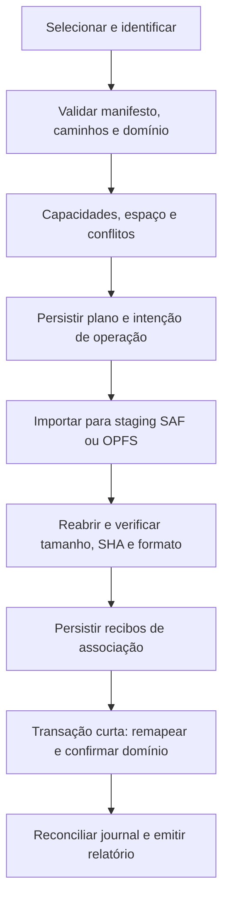

# MinhaEstante 2.0 — Fase 4.1: arquitetura do Backup v2

Data: 29/10/2026. Branch inspecionada: `feature/posse-independente`, inicialmente limpa.

## 1. Resumo e fronteira da entrega

Esta fase acrescenta **contratos e funções puras**, sem exportar/restaurar mídia,
alterar SQLite, provedores, journals, telas ou o ZIP padrão. A implementação está em
`src/services/storage/backupV2/`; sua importação não inicializa serviços. A Fase 4.2
será exportação, a 4.3 será restauração. Nenhuma das duas está funcional nesta entrega.

O legado continua padrão com livros/capas. Cada novo fluxo futuro começa com
`includeEbooks:false` e `includeAudiobooks:false`. Apenas a escolha explícita de uma
categoria encaminhará ao v2. Modalidade, posse e anexo são conceitos independentes.

## 2. Fontes locais e auditoria do backup efetivo

Foram consultados `AGENTS.md`, contexto/arquitetura 2.0, `BACKUP_FORMAT.md`, relatórios
2.2C, 2.3, 2.4, 3.3 e proposta de reautorização 3.3. Quando há divergência, o código
abaixo descreve o comportamento vigente; este documento não amplia suas garantias.

| Responsabilidade | Caminho efetivo |
| --- | --- |
| ZIP, importação JSON e entrega | `src/services/storage/backupService.ts` |
| Tela, seleção ZIP e modos | `src/screens/SettingsBackupScreen.tsx` |
| Entrega multiplataforma | `src/services/nativeService.ts` |
| Seletor de destino e escrita legada Android | `android/app/src/main/java/com/booknookapp/MainActivity.java` |
| Serialização/migração bibliográfica | `src/types/book.ts`, `src/services/storage.ts` (`migrateLegacyBooks`) |
| Livros e parâmetros SQL | `src/services/database/bookRepository.ts` |
| Adaptadores, mutex, transações, esquema | `src/services/database/databaseService.ts` |
| Persistência Web de domínio | `src/services/database/webPersistentDatabaseAdapter.ts` |
| Capas | `src/services/storage/coverStorageService.ts` |
| Anexos, posição, sessões, progresso | `src/services/database/{bookAttachment,readerPosition,readingSession,readingProgress}Repository.ts` |
| Serviço/coordenador de mídia | `src/services/storage/digital/{DigitalFileStorageService,DigitalAttachmentCoordinator}.ts` |
| Contratos e journal individual | `src/services/storage/digital/{contracts,operations}.ts` |
| SAF | `src/services/storage/digital/android/{AndroidSafStorageProvider,bridge}.ts` |
| Streams e journal Android | `android/app/src/main/java/com/booknookapp/{DigitalLibraryStoragePlugin,DigitalStorageCore,AndroidMetadataFiles}.kt` |
| OPFS/journal Web | `src/services/storage/digital/web/{WebOpfsStorageProvider,OpfsFiles,sha256}.ts`, `src/services/storage/web/IndexedDbStore.ts` |
| Regressão histórica sintética | `src/__tests__/{backup_restore,backup_20_10_reference}.test.ts`, `helpers/syntheticLegacyBackup.ts` |

### 2.1 Organização e geração reais

```text
MinhaEstante_Backup_AAAA-MM-DD.zip
  manifest.json
  books.json
  covers/                         entrada de diretório criada por JSZip
    <basename-da-capa>             arquivos locais encontrados
```

`BackupService.exportZipBackup` inicializa o repositório, lê `getAll()`, percorre capas
e serializa os objetos `Book` por spread. A capa encontrada vira referência relativa
`covers/<basename>`; basenames iguais são empacotados uma vez. Se não conseguir ler
a capa, o código mantém `book.capaLocalPath` original como fallback: **a portabilidade
absoluta prometida no documento antigo não é garantida nesse caso**. Não há download
automático de `capaUrl` remota nem coleta de EPUB/PDF/áudio.

O manifesto real contém `appId:'com.booknookapp'`, `appName:'Booknook'`, `version:1`,
`schemaVersion:CURRENT_SCHEMA_VERSION`, `createdAt`, `booksCount`, `coversCount` e
`platform:'cross-platform'`. O campo opcional `checksum` do tipo legado não é produzido
nem conferido pelo serviço. `schemaVersion` bibliográfico não é a versão do SQLite.

Dependência instalada: **JSZip 3.10.2**. A geração usa DEFLATE nível 6 duas vezes:
primeiro Blob, depois Base64. As capas também passam por Base64; há múltiplas cópias
integrais em memória. É comportamento preservado, inadequado como motor para áudio grande.

### 2.2 Dados realmente serializados

| Modelo/campo | ZIP atual | Evolução v2 proposta |
| --- | --- | --- |
| Book, id e uuid | `books.json`; uuid opcional no tipo, gerado pelos repositórios/migração se ausente | uuid obrigatório e estável; id numérico é somente dado da origem, remapear |
| Origem/idExterno, título/subtítulo, autores, editora/ano, páginas, ISBN, gêneros/descrição | Campos de Book | Preservar |
| Posse | `tenho_fisico`, independente do formato | Preservar explicitamente, sem inferência por mídia |
| Modalidades | `formato` e `formatos` | Preservar, sem acrescentar modalidade pela presença de arquivo |
| Status, nota, mês/ano de leitura, observações | Campos de Book | Preservar |
| Cadastro/atualização e empréstimo | Campos de Book, incluindo objeto `emprestimo` | Preservar |
| Capa local/remota | `capaLocalPath`, `capaUrl`, binários locais em `covers/` | Caminhos relativos autorizados e bytes verificados |
| BookAttachment | **Ausente**, inclusive metadados | Projeção portável em `media` do manifesto |
| ReaderPosition | **Ausente** | `reading.json`, somente para mídia incluída |
| ReadingSession | **Ausente** | `reading.json`, bookId substituído por bookUuid |
| ReadingProgress | **Ausente** | `reading.json`, ligado à sessão lógica |

UUID não é sempre UUID v4 estrito no código: existem fallbacks `book-*`, `att-*`,
`sess-*`, `pos-*`. O contrato aceita identificadores estáveis ASCII de 1–128 caracteres
alfanuméricos, `_` e `-`, sem regenerar um ID só por não ter forma RFC. UUIDs ausentes
devem ser materializados e persistidos pelo fluxo existente **antes** do snapshot v2.
Duplicatas e identidades fora desse contrato exigem diagnóstico, nunca remapeamento
silencioso ou alteração do banco nesta fase.

### 2.3 Importação ZIP e reconhecimento histórico

`validateAndExtractZip` carrega o ZIP com `JSZip.loadAsync`, exige manifesto e books,
parseia JSON, verifica apenas `appId` não vazio e `version != null`. Não rejeita uma
versão futura por comparação numérica, nem confere counts/hash/schemaVersion/appId
exato. `books.json` precisa ser array e passa por `migrateLegacyBooks(array,false)`:
preserva registros distintos sem deduplicação por título/autor. Campos antigos
`formato`, categoria/status e posse booleana são normalizados; false explícito de
posse prevalece. UUID ausente é gerado; UUID presente é conservado.

Entradas de capa passam por filtros de caminho e assinatura JPEG/PNG/WebP.
O sanitizador permite caracteres ASCII no basename, converte separadores e devolve
`covers/<basename>`; subdiretórios podem ser achatados. Entradas desconhecidas são
ignoradas com warnings; não há allowlist estrita de todo o ZIP nem limites de expansão,
quantidade, tempo ou total de bytes no serviço. Nomes brutos/duplicados podem ser
normalizados pelo JSZip antes dessa etapa. Esses filtros legados **não equivalem**
às futuras garantias do v2.

Capas extraídas são gravadas antes das alterações de livros. Falhas de gravação são
warnings; `coversRestored` conta gravações bem-sucedidas. A presença da entrada no Map
não prova que sua gravação tenha funcionado. Se uma capa referenciada não foi extraída,
o código consulta armazenamento local; sem encontrá-la avisa, mas mantém a referência.
`saveCoverDirect` grava `Directory.Data` no Android; na Web usa a store legada de capas
(memória/localStorage, data URL). Ela não é a store OPFS de mídias digitais.

### 2.4 Conflitos, substituição e rollback reais

| Modo atual | Comportamento efetivo |
| --- | --- |
| ZIP replace (padrão da tela) | Snapshot em memória **só de livros**, `clearAll()` e depois `bulkInsert()`; conserva IDs do backup |
| ZIP merge | Busca coincidência por uuid **ou ISBN13 ou origem+idExterno**, substitui os campos do encontrado, preservando seu id, uuid existente e dataCadastro; sem coincidência atribui maxId+1; depois `clearAll()` e `bulkInsert()` da lista inteira |
| JSON legado | Aceita array ou `{books:[]}`; chama `migrateLegacyBooks` com deduplicação padrão ativa; converte `data:image` para capa; replace limpa e insere; merge acrescenta com novos ids e reconstrói lista |

Logo, a descrição antiga de merge como simples acréscimo sem sobrescrita não é exata
para ZIP. ISBN13 com UUID diferente também pode mesclar no legado. Título/autor não
são critérios do merge ZIP; podem participar da migração JSON legada.

`bulkInsert` tem transação própria e 27 colunas/placeholders alinhados. `clearAll`
fica fora dela; não há transação global do restore. Em replace, uma falha tenta
repor snapshot bibliográfico quando ele não está vazio. Falha ao capturar snapshot
não interrompe a execução. Merge/JSON não possuem a mesma compensação explícita.
As FKs em SQLite e cascatas do interpretador Web removem anexos, posições, sessões
e progresso ao limpar livros; esses modelos não estão no snapshot do backup.
Capas já escritas também não são desfeitas. **Não afirmar rollback integral**.

Operações potencialmente destrutivas: clearAll em ambos os modos ZIP, substituição
de metadados em merge e sobrescrita de capa no mesmo caminho. O índice uuid do SQLite
é índice de busca, não garantia suficiente de unicidade; o v2 precisa validar isso.
Nenhum desses comportamentos foi modificado aqui. Sua revisão requer escopo próprio;
o novo restore não deverá copiar esse algoritmo para tratar mídia/histórico.

### 2.5 Destino, seleção e limitações de entrega

Android empacotado com `AndroidApp.createFile`: `ACTION_CREATE_DOCUMENT`, nome sugerido,
usuário escolhe destino; a bridge recebe Base64 completo e escreve bytes via
ContentResolver. O fallback Capacitor usa Cache+Share, depois Web Share quando possível,
senão download por âncora/Blob. Navegador controla o destino final do download.
Importação usa input File e confirmação replace/merge. O timeout de 60 s da entrega
personalizada resolve true; acionar download/share não prova durabilidade do arquivo.
O v2 precisa de protocolo distinto de finalização, sem mudar essa bridge agora.

## 3. Compatibilidade e seleção de formato

- Duas opções falsas: manter **exatamente** o serviço legado e sua estrutura.
- Uma ou duas verdadeiras: futuro fluxo separado v2, com `format` e `backupVersion:2`.
- `manifest.json` **já existe**: reutilizar o nome em outro formato discriminado,
  nunca criar dois manifestos na mesma raiz. V2 não emite `appId`/`version` do legado;
  isso faz o importador antigo rejeitá-lo por campos ausentes, antes de aplicar livros.
- `identifyBackupManifest` é somente função futura de despacho. Não está conectada à UI.
  Versões futuras/ambíguas não caem no legado. O importador legado continua intacto.
- Não exigir manifesto v2 de backups históricos, nem inserir campos novos no ZIP padrão.

Regressão pública usa fixture sintética com **215 livros, 207 capas, 141 possuídos,
97 lidos**, incluindo ciclo persistir/exportar/reimportar nos testes anteriores.
A referência pessoal não foi aberta nem copiada nesta fase. As contagens são cenário
de teste, não autorização para divulgar seu conteúdo.

## 4. Estrutura v2 proposta

```text
backup.zip
  manifest.json
  books.json                     mesmo modelo bibliográfico, uuid obrigatório
  reading.json                   readerPositions, sessions, progress
  covers/<identificador>.jpg      também jpeg/png/webp
  media/ebooks/<attachment-id>.epub|pdf
  media/audiobooks/<attachment-id>.mp3|m4a|m4b
```

Nomes de mídia derivam exclusivamente do ID lógico do anexo. Nome original fica como
metadado de exibição; não vira destino de extração. Capas v2 devem receber nome único
por identidade gerada no planejamento e mapa explícito para `capaLocalPath`, evitando
colidir com capas existentes. Não reaproveitar automaticamente basename para sobrescrever.
Hash/tamanho de **todos os payloads** (books, reading, capas e mídia) ficam no manifesto;
o manifesto não contém seu próprio hash. A ordem física pode deixar manifesto por último,
pois só após streaming se conhecem hashes reais e omissões. O restore precisa de leitura
limitada do diretório central/seek ou staging controlado para ler manifesto antes de extrair.

## 5. Esquema e evolução do manifesto

O esquema definitivo desta fase está em `BackupV2Manifest` em `contracts.ts`.

| Campo | Obrigação e significado |
| --- | --- |
| format, backupVersion | Literais `minhaestante-backup`, `2`; independentes da versão SQLite |
| backupId, createdAt | Identidade da cópia e instante UTC ISO com segundos, opcionalmente milissegundos |
| appVersion | Opcional, versão pública do aplicativo; não usar versão do schema como substituta |
| options | Dois booleanos independentes; pelo menos um true para v2 |
| counts | books, covers, eligibleMedia, includedMedia, omittedMedia, unavailableMedia; inteiros coerentes |
| bibliography, reading | Descritores obrigatórios dos arquivos fixos books.json e reading.json |
| covers | Lista de descritores de capas, pode ser vazia |
| media | Slots encontrados, incluídos ou omitidos, pode ser vazia |
| acknowledgedOmissions | IDs de todas as falhas selecionadas reconhecidas, sem extras/duplicatas; obrigatório mesmo vazio |

`eligibleMedia` conta todos os anexos descobertos, inclusive categorias desmarcadas.
`omittedMedia` inclui opt-outs e falhas; `unavailableMedia` é o subconjunto solicitado
que falhou. Livros sem anexo não geram mídia fictícia. `includedMedia` é número de
arquivos digitais efetivamente gravados/verificados, não número de formatos do catálogo.

Cada descritor de arquivo exige `archivePath`, `sizeBytes` inteiro seguro e `sha256`
hexadecimal minúsculo de 64 caracteres. `BackupPortableAttachment` preserva id, tipo,
formato, filename, criação/atualização e bookUuid. Não leva bookId numérico, provedor,
referência física, URI, concessão, diretório privado ou token de leitura.

`BackupMediaEntry` é união discriminada:

- `state:'included'`: tamanho conhecido, SHA-256 e caminho canônico obrigatórios.
- `state:'omitted'`: reason obrigatório, nenhum archivePath; tamanho/hash podem ser
  `null` se desconhecidos. Um hash histórico não prova acesso atual nem arquivo incluído.

Campos desconhecidos são rejeitados nesta versão, inclusive os físicos. Campos
opcionais futuros exigirão revisão explícita da allowlist e testes de compatibilidade;
mudança de semântica obrigatória exige nova backupVersion. Não há framework de migrações
nem extensão arbitrária que possa transportar credenciais. Não se promete que um leitor
v2 antigo aceitará automaticamente toda futura extensão opcional.

## 6. Inclusão, omissão e resultado

| Opções | Resultado planejado |
| --- | --- |
| false / false | Legado, livros/capas; nenhuma leitura de mídia pelo fluxo padrão |
| true / false | V2, solicita e-books, áudio omitido por opção |
| false / true | V2, solicita áudio, e-books omitidos por opção |
| true / true | V2, solicita ambas as categorias |

Motivos distintos: `category-not-selected`, `temporarily-unavailable`,
`permission-required`, `file-not-found`, `read-error`, `integrity-error`,
`insufficient-space`. Não converter indisponibilidade em inexistência. Quota/espaço
de uma entrada podem admitir parcial; falha ao escrever/finalizar o contêiner inteiro
invalida o backup, mesmo com omissões aceitas.

Política conservadora recomendada: `failurePolicy:'abort'` inicialmente. A alternativa
`allow-acknowledged-partial` exige apresentação e aceitação dos IDs omitidos antes da
publicação do arquivo final. Mudança de erro durante a execução exige nova confirmação;
um aceite genérico anterior não autoriza omissões adicionais. `assessBackupExportResult`
distingue complete, partial, cancelled, failed e attention-required; nenhuma conclusão
sem finalização confirmada. Opt-out é escolha inicial, não falha que exige novo aceite.
O helper pressupõe registros finais coerentes; o manifesto e inventário devem ser
validados antes de um executor futuro chamá-lo. Os contratos não verificam bytes sozinhos.

## 7. Portabilidade e sanitização

`portableBackupAttachment` faz projeção explícita; nunca serializar BookAttachment
por spread. `books.json` legado contém uma localização física possível: capaLocalPath.
Na futura exportação v2, projetar somente campos Book conhecidos e substituir cada
caminho por entrada autorizada de capa ou null com relatório. Na futura importação,
validar todos os registros e exigir UUID único antes de usar a lista como contexto
do manifesto; rejeitar propriedades físicas desconhecidas. `capaLocalPath` precisa
resolver uma capa autorizada, nunca file/content/OPFS ou diretório do aparelho de origem.
`capaUrl` aceita somente URL remota apropriada ou null; Base64 deve ir para capa binária,
nunca permanecer como buffer de mídia. Essa sanitização bibliográfica executável é
requisito da 4.2/4.3; não foi ligada à serialização atual.

Android→Web e Web→Android transportam bytes idênticos. No destino, importações locais
geram tokens e novos `StoredDigitalFile` verificados, preservando identidade lógica
se não houver conflito. O planejamento recebe mapas bookUuid→bookId,
attachmentIdOrigem→attachmentIdDestino e sessionIdOrigem→sessionIdDestino.
`planVerifiedBackupBinding` somente prepara argumento futuro de repositório, depois de
conferir livro lógico, ID, formato, tamanho e SHA do recibo de destino. Não escreve no
banco e não autentica um recibo fabricado: o executor precisa obtê-lo do provider real.
Renovar pasta padrão não remapeia tokens antigos nem equivale a restaurar bytes.

## 8. Posição, sessões e progresso

`BackupReadingData` reutiliza modelos canônicos. Posições referenciam attachmentId;
sessões trocam bookId por bookUuid; progresso mantém sessionId, com mapa futuro.

Somente posições da mídia incluída integram `reading.json`. Posição com mídia omitida
fica fora do payload e deve constar no relatório de posições não transportadas, sem
criar vínculo provisório. Omissão de posição não apaga o original. Após importar e
verificar SHA/formato/tamanho, `planBackupReaderPosition` exige evidência do destino,
remapeia attachmentId e conserva ID/local/data. PDF não recebe CFI e áudio não recebe
página. Validação básica de CFI segue o domínio existente; não é parser completo EPUB.

Uma posição por anexo; não sobrescrever posição existente por timestamp automaticamente.
Conteúdo idêntico com posição já existente é conflito explícito, conservando a posição
local até decisão. Conteúdo diferente nunca recebe posição anterior. Mesmo SHA sem
compatibilidade de formato não basta.

Sessões/progresso são preservados **mesmo sem arquivo digital**; livros físicos seguem
válidos. Uma sessão ativa por livro, um progresso por sessão, IDs únicos e FKs lógicas
são validados. O modelo atual é progresso por sessão, não trilha de todas as marcações.
IDs iguais com dados iguais poderão ser reconhecidos idempotentemente; divergentes ou
duas sessões ativas exigem resolução, sem descartar história. Repositórios atuais não
oferecem toda a importação preservando IDs/datas; prever APIs de importação controlada
em 4.3 antes de modificá-los. Nenhuma sessão/status é iniciada por abrir/restaurar mídia.

## 9. Conflitos e biblioteca existente

| Cenário v2 | Proposta conservadora, ainda sem executor |
| --- | --- |
| Biblioteca vazia | Importar mantendo UUIDs; gerar IDs numéricos de destino; confirmar tudo após staging |
| Biblioteca existente, merge | Acrescentar identidades novas; não limpar lista; analisar conflitos antes de escrever |
| Mesmo UUID de livro | CONFLICT/pending; manter existente até decisão; nenhuma sobrescrita implícita |
| Mesmo ISBN13, UUID diferente | Avisar, propor manter como registro separado; ISBN não decide identidade |
| Mesmo origem+idExterno | Conflito informativo revisável; não herdar regra destrutiva do legado |
| Mesmo título/autor | Não deduplicar automaticamente |
| Mesmo ID lógico de anexo | Revalidar livro/tipo/formato/hash e propriedade do destino; divergência bloqueia |
| Mesmo slot, ID diferente, hash igual | Propor reuse-verified depois de verificar arquivo local e resolver posição |
| Mesmo slot, conteúdo diferente | Manter anexo válido; substituir somente por intenção explícita e decisão de posição |
| Mesmo hash em livros diferentes | Não fundir livros/anexos; compartilhamento físico exige suporte/propriedade do provider |
| Posição/sessão local | Preservar até resolução; sessão ativa concorrente bloqueia associação do histórico conflitante |
| Falha de novo arquivo | Não tocar no vínculo local; reter preparo e recibo para recovery |
| replace-explicit | Confirmação específica, snapshot integral/rollback durável planejado e todos os novos bytes verificados antes de trocar domínio |

`findBackupBookConflicts` apenas relata coincidências, com resolução pending. Não há
merge/substituição implementados. A matriz de resolução, especialmente replace e
conflitos de histórico, exige aprovação de produto antes da 4.3. O usuário desta fase
autorizou a proposta, não operações destrutivas reais. O contrato `readyToCommit` deve
continuar false enquanto houver pendência, falta de capacidade ou evidência incompleta.

## 10. Validação prévia, integridade e ZIPs hostis

Ordem futura: selecionar → identificar versão → limitar/ler diretório central e
manifesto → parsear manifesto limitado → validar books e UUIDs → validar manifesto
contra UUIDs reais → inventariar entradas brutas → validar reading e referências de
capas → capacidades/espaço/conflitos → staging incremental → verificar → associar.
Ler metadados JSON com limites próprios não é extrair mídia arbitrária. Manifesto
por último no ZIP não autoriza extração sequencial cega das entradas anteriores.

Validadores puros desta entrega:

| Função | Garantia estrutural |
| --- | --- |
| identifyBackupManifest | Discriminador legado/v2; rejeição de versão incompatível |
| parseBackupV2Manifest | Limite UTF-8 antes de JSON.parse e validação estrutural |
| validateBackupV2Manifest | Campos, versão, contagens, categorias, IDs/slots, hashes, tamanhos, referências bibliográficas e aceite de falhas |
| isSafeBackupPath / backupMediaPath | Caminhos relativos canônicos, ASCII e profundidade; nome estável por ID |
| validateBackupArchiveEntries | Inventário por Iterable, duplicatas/case collisions, entradas permitidas, tipos, tamanhos/expansão/total |
| validateBackupProcessingBudget | Limites de bytes **observados**, expansão e tempo durante streaming |
| validateBackupFileIntegrity | Comparação tamanho/hash observado com descriptor |
| validateBackupReadingData | FKs lógicas, formato de posição, unicidade e valores finitos |

`validateBackupV2Manifest` recebe objeto já parseado; para entrada externa é obrigatório
usar o parser limitado e limitar também a leitura UTF-8 no adaptador. Tamanho declarado
não basta: interromper descompressão antes de exceder orçamento/contagem reais, não
somente depois de produzir buffer. `books.json` e `reading.json` precisam de leitura
limitada por descriptor e política JSON específica; não alocar 16 GiB para JSON só
porque o teto de mídia permite. O executor futuro deverá impor um teto menor de
metadados conforme dispositivo e parsing incremental para bibliotecas extensas.

Não aceitar absolutos, `..`, pontos isolados, barras invertidas, vazios, percent encoding,
controles, diretórios inesperados, arquivo não listado, faltantes, criptografia, codec
desconhecido, links/specials. Diretórios ZIP opcionais são apenas covers/, media/ e
suas duas categorias, tamanho zero. Colisões de nomes são rejeitadas também sem
distinguir maiúsculas, evitando resultados dependentes do destino.

O adaptador deve preservar nomes **brutos** e duplicatas antes de normalização; uma
Map já carregada por JSZip não demonstra isso. Conferir central/local headers,
offsets, limites de leitura, fim do arquivo, data descriptors e tipos Unix/DOS;
rejeitar ZIP truncado/inconsistente e entradas especiais. Os helpers não leem ZIP,
não verificam magic bytes nem detectam truncamento por si. O executor precisará fazer
essas verificações e manter a validação básica de conteúdo dos provedores, mesmo com
extensão/hash corretos. Nunca usar archivePath como caminho de escrita do dispositivo:
o provider cria um destino gerenciado de identidade nova.

SHA-256 de bytes descomprimidos permite detectar inconsistência; CRC ZIP não substitui
essa comparação. Um terceiro pode alterar bytes **e** manifesto: não há autenticidade,
assinatura criptográfica ou criptografia de backup nesta fase.

## 11. Limites configuráveis e ZIP64

| Política provisória de segurança | Padrão configurável |
| --- | --- |
| Arquivos/entradas ou registros lógicos por grupo validado | 100.000 (diretórios contam no inventário) |
| Entrada descomprimida | 16 GiB |
| Total descomprimido | 256 GiB |
| Profundidade de caminho | 3 segmentos |
| Manifesto UTF-8 | 16 MiB |
| Expansão por entrada | 1.000×, inclusive observada |
| Processamento | 24 h de orçamento máximo; cancelamento não aguarda esse prazo |

São tetos de política para análise/testes, **não capacidade implementada**, garantia
de memória disponível ou bloqueio fixo de audiolivros em centenas de MiB. O motor terá
de aplicar o menor entre esses tetos e limites técnicos comprovados (números inteiros
seguros JS, offsets reais da biblioteca, quota, armazenamento/provedor e orçamento de
metadados). Adaptações conscientes da política não podem autorizar path traversal,
FK inválida ou hash divergente. Contagens e somas são verificadas contra overflow.

ZIP clássico usa tamanhos/offsets de 32 bits e contagens de 16 bits; limites próximos
de 4 GiB/65.535 entradas exigem ZIP64. O gerador instalado do JSZip escreve esses campos
em 4/2 bytes (`lib/generate/ZipFileWorker.js`); não é base aprovada para gerar ZIP64.
A documentação também registra limitações na leitura ZIP64 e retenção do resultado
inteiro por generateAsync. [Limitações oficiais JSZip](https://stuk.github.io/jszip/documentation/limitations.html).

Android e Web v2 não possuem motor escolhido/ensaiado para esses limites. Antes de
habilitar ZIP64, testar entrada >4 GiB, soma/offset >4 GiB e >65.535 entradas, tanto
exportação quanto importação cruzada e interrupções, em ambientes controlados.
Enquanto não comprovado, bloquear operação que ultrapasse o limite técnico informado,
com relatório explícito; não prometer vários GiB usando somente fixtures de metadados.

## 12. Estratégia Android recomendada (Fase 4.2)

Recomendar motor ZIP **nativo Kotlin**, com ContentResolver e buffers limitados,
controle por IDs/recibos e progresso pela bridge. `DigitalStorageCore` já usa 64 KiB,
MessageDigest, journal e releitura; reutilizar princípios/helpers de acesso sem
misturar os estados de backup nos recibos de importação individual. Hoje
`AndroidSafStorageProvider.acquireReadAccess/releaseReadAccess` retornam unsupported:
não existe exportação grande pela API atual. A seleção da pasta ativa não é acesso
portável a todos os anexos. Cada arquivo exige resolver seu token privado e concessão.

SAF oferece `ACTION_CREATE_DOCUMENT` para destino escolhido e acesso via URI concedida;
não precisa ampliar permissões para todo armazenamento. O novo fluxo deve conservar
essas referências somente no registro privado. [Android SAF](https://developer.android.com/training/data-storage/shared/documents-files).

Avaliar `java.util.zip.ZipOutputStream`: permite gravação sequencial e finish/close,
reduz cópias/bridge e integra SHA incremental. Isso não demonstra sozinho leitura
hostil segura, atomicidade SAF ou ZIP64 no Android mínimo do app; validar implementação
ART/libcore e versões suportadas antes da escolha final. Alternativa é biblioteca
nativa especializada se inspeção de entradas brutas/ZIP64 não puder ser garantida.
[API Android ZipOutputStream](https://developer.android.com/reference/java/util/zip/ZipOutputStream).

Bridge incremental de blocos JS é alternativa, mas aumenta cópias/overhead, obriga
backpressure, mantém offsets seguros e reinício coordenado em dois runtimes; não
recomendada como primeira implementação. Não trafegar Base64. Progresso e cancelamento
cooperativos, worker fora da thread principal, close/finalização/releitura comprovados.
Conteúdo já comprimido: comparar STORE com DEFLATE; STORE pode exigir tamanho/CRC
antecipado no motor escolhido (leitura prévia limitada), sem buffer integral.

Destino SAF pode não oferecer rename/substituição atômicos. Preferir staging privado
ou documento claramente incompleto + recibo privado, depois publicação final e
reverificação. Uma cópia temporária integral em disco pode ser necessária e deve ser
estimada. Se o provedor não permitir renomear, registrar visibilidade de parcial e
marcar sucesso apenas após finish, close e confirmação possível do destino. Cloud
providers podem não garantir sincronização remota: informar limite, sem sucesso por timeout.

## 13. Estratégia Web/PWA recomendada (Fase 4.2)

OPFS atual obtém File/Blob handle, copia/reverifica em blocos de 256 KiB e mantém
SHA incremental próprio. `resolveReadAccess` entrega Blob sem exigir arrayBuffer
integral. Adaptar futura porta para stream/chunks, liberar token ao terminar e usar
backpressure. Worker dedicado para ZIP/hash mantém UI responsiva; limitar filas e
concorrência. Não usar Service Worker como promessa de operação longa após fechar PWA.

JSZip instalado pode emitir chunks via StreamHelper, mas o fluxo atual usa Blob e
Base64 integrais e não resolve ZIP64 seguro. Comparar uma biblioteca de streaming
com entradas brutas verificáveis e ZIP64. **zip.js é candidata à prova técnica**, por
declarar Streams, workers e ZIP64; não foi instalada, selecionada definitivamente
nem validada no app. [Documentação oficial zip.js](https://gildas-lormeau.github.io/zip.js/).

Preferir sink externo incremental quando `showSaveFilePicker` e createWritable
estiverem disponíveis no gesto do usuário. A API de File System Access possibilita
escrita direta com concessão, mas requer detecção por capacidade, contexto seguro
e interação. Isso é distinto de OPFS privado; suporte do seletor não deve ser inferido
por haver OPFS. [Guia do Chrome](https://developer.chrome.com/docs/capabilities/web-apis/file-system-access).

Para Firefox/Chrome Android/PWA sem sink externo compatível, avaliar staging ZIP em
OPFS + exportação de File/compartilhamento conforme suporte e tamanho comprovado.
Não chamar Blob inteiro de streaming nem supor que ancorar File garanta cópia sem
memória no navegador. Se entrega grande não for viável, informar capability/limite
e manter backup padrão; alternativas como múltiplos volumes exigem outro contrato.
PWA instalada não amplia automaticamente APIs, quota ou duração da execução.

## 14. Espaço e pré-processamento

`BackupExportPlan` distingue total bibliográfico/capas, contagens de cada categoria,
candidatos acessíveis, omissões, bytes conhecidos/desconhecidos e warnings.
`BackupSpaceEstimate` possui availableBytes/estimatedAdditionalBytes anuláveis e
`assurance:'estimate-only'`. O planner puro deixa estimativa física null: não inventa
compressão, overhead, espaço externo nem capacidade do destino.

Futuro preflight considera mídia selecionada, capas/metadados, índice ZIP, staging,
releituras/promoção e retenção existente. Restore OPFS atual pode manter staging e
committed (perto de duas cópias ou mais); adicionar ZIP temporário pode elevar isso.
Não remover arquivos válidos para abrir espaço. Tamanho desconhecido usa progresso
sem percentual e aviso; disponibilidade consultada pode mudar após planejamento.

SAF externo/nuvem pode não reportar espaço real. No navegador, `storage.estimate`
é aproximado; não tratar como reserva. [Storage estimate](https://developer.mozilla.org/en-US/docs/Web/API/StorageManager/estimate).
Ausência de estimativa ou aproximação conservadora gera atenção, não bloqueio rígido
de uma operação legítima. Falta efetiva de quota/espaço ou limite técnico comprovado
é erro; checks continuam durante escrita.

## 15. Operações incrementais, progresso e cancelamento

`BackupOperationProgress` identifica direção, operação, etapa, arquivos, bytes,
totais anuláveis e cancellable. Etapas: planning, validating, preparing, transferring,
verifying, linking, finalizing, reconciling e estados terminais. Não apresentar 100%
ou complete antes de finalizar saída/associação e checkpoints. `committed` no resultado
lista apenas IDs confirmados; planejamento, mídia preparada e commit são distintos.
Exportação não compromete registros bibliográficos e deixa committed vazio.

`BackupOperationContext` possui AbortSignal e callback. Cancelar interrompe streams
cooperativamente, fecha/aborta escrita e registra estado; não significa apagar o que
já existe. Antes de confirmar metadados, pode cancelar conservando biblioteca. Depois
do commit, reconciliar e relatar o efetivamente confirmado; não fingir rollback.
Fechar aplicativo/navegador deixa operação recuperável, sem promessa de trabalho em
background. Prazo de processamento é orçamento de segurança, não timer que prova falha
de uma operação ainda durável.

## 16. Restore, atomicidade, journal e recovery (Fase 4.3)



Proposta: journal **coordenador de backup**, versionado e privado, compondo os journals
individuais existentes por child operationId. `BackupOperationCheckpoint` define
identidade da operação/backup, digest do plano, direção/etapa, filhos, entradas
verificadas, dados já confirmados, estado da saída e cancelamento. É contrato, não
implementação de journal novo. Os tokens locais/handles do destino, snapshot completo
e intenções de compensação são responsabilidade do registro privado futuro, nunca
do manifesto portável. Estados de backup não serão inseridos no enum de importações.

Pontos duráveis e retomada:

1. Antes de criar saída/staging: plano estável, versão/digest e intenção registrados.
   Reabrir a origem exige validar novamente backupId e hash do plano/manifesto.
2. Antes de cada criação: child ID determinístico vinculado a operação+anexo. Falha
   usa o recibo do mesmo arquivo; nunca adota um desconhecido por nome semelhante.
3. Após verificação: tamanho/hash reais e referência local privada duráveis. Entrada
   concluída não se presume válida após reinício; revalidar antes de associar.
4. Antes de associar: recibo com expectativa de UUID/slot/revisão e decisão de conflitos.
   Todas as cópias/hash ficam fora da transação SQLite/IndexedDB.
5. Commit curto de metadados (incluindo livros/capas/posições/sessões/progresso):
   reconsultar concorrência, confirmar só vínculos para bytes válidos e gravar recibo
   recuperável do conjunto. Garantia integral depende de APIs/snapshot duráveis a
   projetar em 4.3, sem modificar agora mutex, migrações ou transações estabilizadas.
6. Se commit confirmou mas journal não: comparar domínio real/recibos e apenas
   finalizar, sem duplicar livros, anexos, posição ou sessão. Se não confirmou:
   manter biblioteca antiga e novas cópias preparadas para retomar/revisar.
7. Exportação interrompida: ZIP sem diretório central/finalização não é válido. Retomar
   inicialmente significa reconstruir saída própria, não append cego. Exportação
   concluída não apaga mídias originais.

Uma transação SQLite **não desfaz arquivos**. Rollback de domínio preserva estado
anterior; arquivos novos não vinculados podem continuar retidos. Limpeza futura exige
propriedade comprovada, ausência de vínculos e autorização/política explícita, incluindo
janela de criação SAF sem URI. Nada é apagado automaticamente nesta fase. Replace
precisa de snapshot durável integral e estratégia que resista a fechamento antes de
ser habilitado; não reutilizar snapshot apenas bibliográfico do legado.

## 17. Matriz de decisões

| Decisão | Alternativas | Recomendação | Justificativa |
| --- | --- | --- | --- |
| Formato padrão | Legado / v2 | Legado; v2 apenas por seleção | Compatibilidade de bibliotecas pessoais, sem alteração silenciosa |
| Manifesto | Único / múltiplos | Um manifest.json por ZIP, discriminado | Nome já existe; evitar ambiguidade e aceitar v2 como legado |
| Hash | Por arquivo / global | SHA-256 por payload | Validação incremental e identificação do erro; sem promessa de autenticidade |
| Exportação Android | Kotlin nativo / bridge incremental | Kotlin, prova do motor pendente | I/O nativo já limitado; readAccess nativo ausente e Base64 inadequado |
| Exportação Web | Streaming / Blob completo | Streaming com sink real; zip.js candidata | Resultado integral atual não serve de base para áudio grande |
| ZIP64 | Suportado / limitado | Não habilitar até prova cruzada | JSZip atual não é gerador ZIP64 aprovado; testes de limites faltam |
| Anexo omitido | Descartar vínculo / pendência explícita | Metadado/relatório de omissão, sem vínculo local válido | Não fabricar arquivo nem copiar tokens |
| Falha parcial | Abortar / parcial confirmado | Abortar por padrão; parcial só por aceite específico | Backup completo precisa refletir o efetivamente preservado |
| Conflito UUID | Mesclar / substituir / rejeitar | Bloquear para revisão; nenhuma sobrescrita automática | Legado tem efeitos destrutivos; identidade igual não autoriza overwrite |
| ReaderPosition | Validada / invalidar | Restaurar somente com bytes/formato/hash verificados e conflito resolvido | Posição pertence ao conteúdo, não ao título |
| Restauração | Etapas recuperáveis / única | Etapas com staging e commit curto | Não manter transação durante gigabytes de I/O |
| Journal | Compartilhado / coordenador de backup | Coordenador composto com journals individuais | Preservar recovery estabilizado, correlacionar operação inteira |

## 18. Validação desta fase e próximos critérios

Fixtures são pequenas/sintéticas; metadados de 8 GiB não criam arquivo real. Os testes
novos cobrem as 34 categorias solicitadas, incluindo manifesto/versão/campos,
integridade, paths/inventário/limites, quatro seleções, omissões/falhas/parcial,
portabilidade, reconstrução futura, posição órfã, conflitos e estrutura histórica.
Testes existentes não foram editados para acomodar outro formato.

| Verificação efetivamente executada | Resultado |
| --- | --- |
| Baseline `npm test` | 614 testes, 35 arquivos, zero falhas |
| Suíte final `npm test` | **722 testes, 36 arquivos, zero falhas** |
| Novos testes de contrato | **108**, todos aprovados em backup_v2_contracts.test.ts |
| Regressão existente | 614 anteriores preservados: ZIP/restore histórico sintético, SQLite desktop/doubles nativos, livros/capas/posse/formatos/status, anexos/posição/sessões/progresso, journals/SAF/OPFS |
| `npm run lint` | TypeScript `tsc --noEmit` aprovado |
| Web/PWA `vite build --outDir /tmp/minhaestante-4-1-web --emptyOutDir` | Aprovado; aviso preexistente de chunk >500 kB |
| `git diff --check` | Aprovado |
| JVM/Gradle, dispositivo Android e browser runtime | **Não executados nesta fase**, sem alteração Kotlin/provedor/UI/SQL |
| Backup pessoal externo | Não aberto; somente fixtures sintéticas |

Não se executou o script composto `npm run build`, pois inclui `cap sync android || true`.
TypeScript e build Web foram executados separadamente, com saída temporária; não há
evidência nova de compilação/sincronização ou transação nativa Android. Os 32 testes
JVM reportados na 3.3 são evidência histórica, não reexecução desta entrega. Testes
de contrato/doubles e metadados grandes não demonstram streaming, ZIP64 ou I/O físico.

Para iniciar 4.2: aprovar esquema/omissões, provar motor ZIP64 e inventário bruto,
contrato Kotlin de exportação para destino SAF, contrato Web de source/sink incremental,
metadados JSON limitados, snapshot consistente entre domínio e arquivos (conferir
revisões/locks sem segurar transação longa), espaço/cancelamento/journal e ensaio de
memória. Adicionar depois as duas opções de UI desmarcadas, mantendo legado padrão.

Para iniciar 4.3: além do acima, aprovar matriz de conflitos, persistência dos mapas e
recibos, importação controlada de sessões/posições com IDs/datas, commit/rollback integral
de domínio e revalidação concorrente. A porta atual importFile recebe origem escolhida,
não stream de entrada ZIP: definir extensão explícita para conteúdo preparado pelo
backup, preservando recuperação e sem simular um seletor. Testar Android↔Web com
integridade, biblioteca vazia/ocupada, mortes de processo em cada ponto durável e
falhas após commit, sem dados pessoais.

Permanecem Safari real, leitores de tela, provedores SAF adicionais e reautorização
direcionada; são limites históricos, não aprovados por testes puros novos. Publicação
continua bloqueada pelos materiais privados históricos documentados em 2.4/3.3.
Não houve saneamento de histórico, distribuição, commit/push, APK/AAB, cap sync,
permissão nova, versão/assinatura ou acesso a biblioteca pessoal nesta fase.


## Adendo — evidência da Fase 4.2A (29/10/2026)

A prova isolada foi implementada e medida no
[relatório 4.2A](MINHAESTANTE_4_2A_ZIP_STREAMING_INTEROP.md). Os contratos acima
continuam vigentes; o backup público segue v1. zip.js 2.24.0 está instalado somente
como devDependency experimental, sem inclusão no bundle público. Kotlin debug usa
ZipOutputStream/ContentResolver, Web usa Streams e OPFS existentes.

ZipFile↔zip.js foi validado com manifesto e hashes, incluindo Android físico.
ZipInputStream rejeitou arquivos Web com descriptors/ZIP64 no JDK21: o leitor futuro
precisa de seek/staging limitado ou outra engine demonstrada. ZIP64 estrutural e
65.536 entradas foram provados; ZIP/entrada/offsets >4 GiB continuam não comprovados.
Os limites de 16/256 GiB são política, não promessa de capacidade.

SAF externo e Chrome desktop externo pequeno passaram; Firefox não ofereceu o picker;
Chrome Android externo permanece parcial, com falha de readback. OPFS não é entrega
externa. Worker e responsividade são requisitos antes de integrar operações longas.
Resultado: 761 Vitest, 47 JVM, TypeScript, builds Web/PWA/experimental/DEV aprovados;
SAF físico e três browsers reais ensaiados. Nenhuma exportação pública/restauração,
SQL, migração, versão/assinatura principal, commit/push ou publicação nesta fase.

## 22. Adoção dos contratos pela Fase 4.2B (30/10/2026)

O exportador real DEV consome os contratos/validadores acima sem relaxar suas regras:
[relatório 4.2B](MINHAESTANTE_4_2B_BACKUP_EXPORT.md). Snapshot coerente por repositórios,
reading portável, mídia opcional, manifesto ao final, verificação do destino, Worker
Web e engine SAF nativa foram implementados. V1 segue exatamente no serviço anterior.
Os checkpoints são agora usados por journal de exportação próprio; a política inicial
aborta mídia solicitada inválida, sem habilitar a parcialidade contratual futura.

Leitura posicionável usa ZipFile/cache privado no Android; ZipInputStream não é leitor
universal. Limites DEV comprovados são menores que os tetos propostos nesta fase.
Restauração, conflitos e associação a partir de backup continuam sem implementação;
a futura 4.3 não deve confundir estes contratos com um restaurador pronto.
